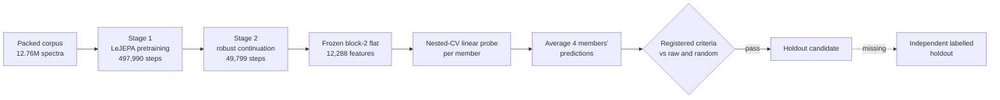
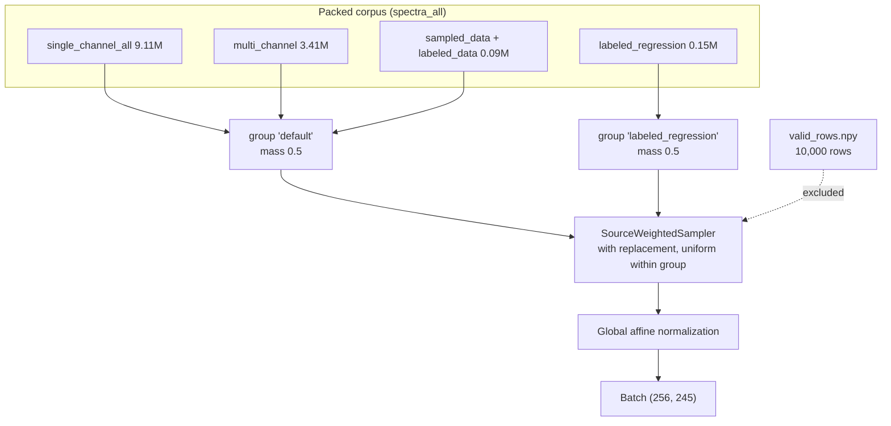
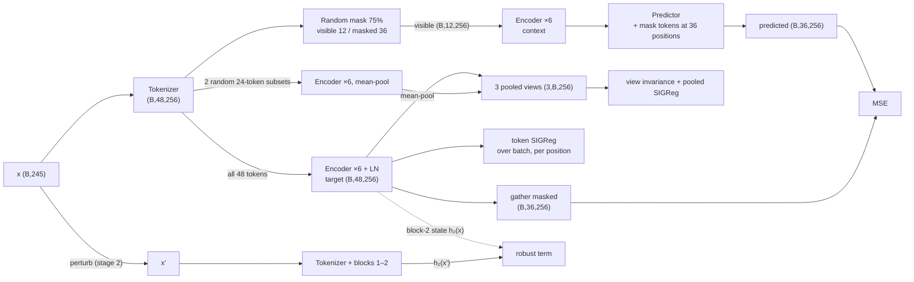
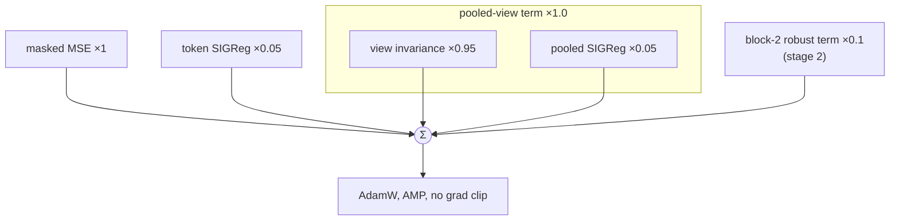
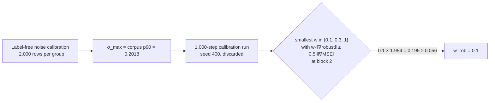
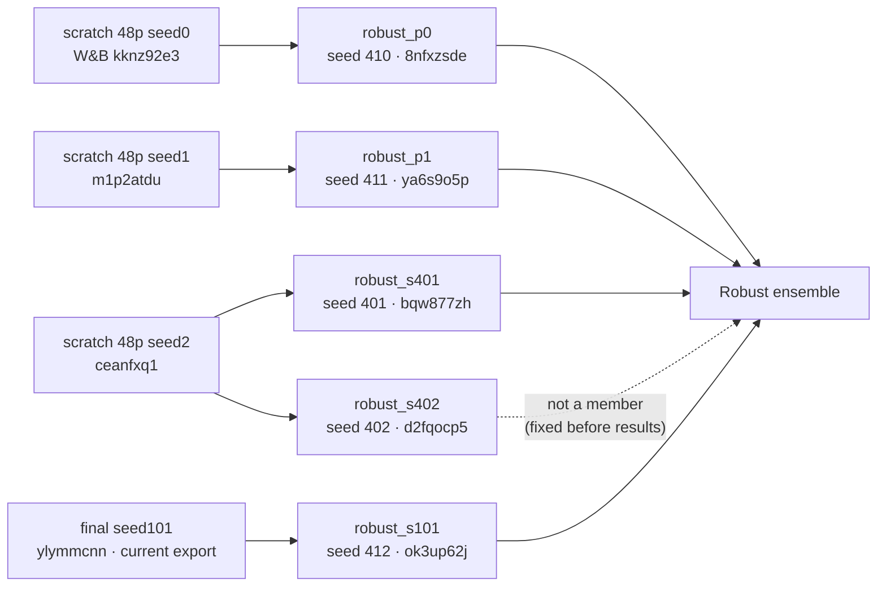
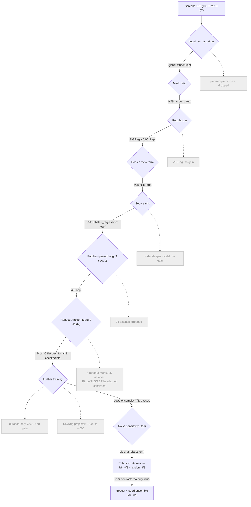
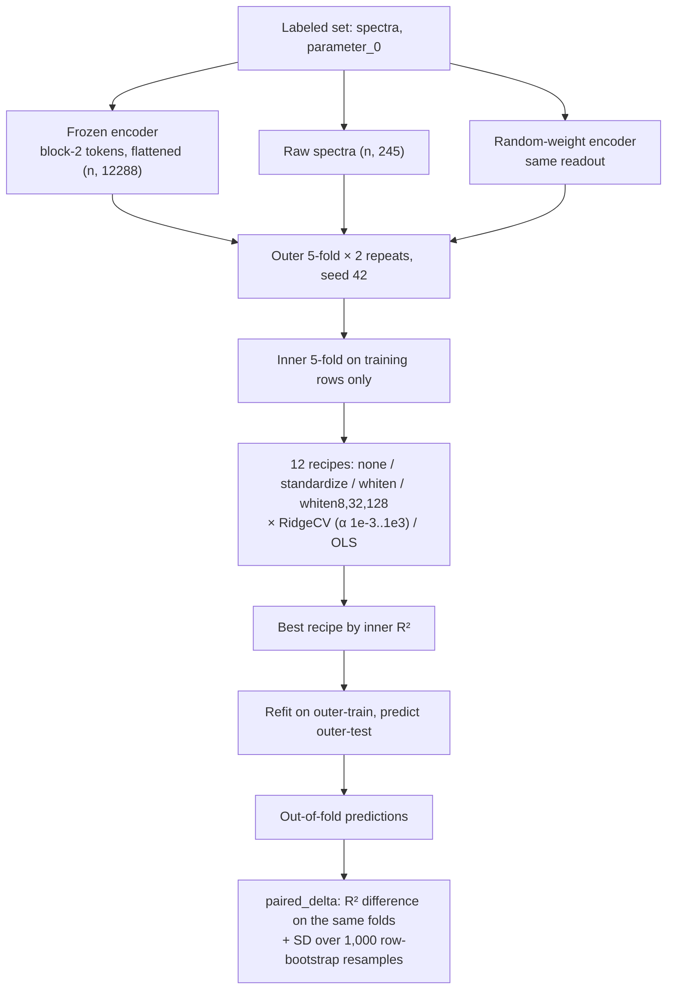

# SpectralFM-LeJEPA training report

Status 2026-10-14. Covers the recipe and evidence behind the current candidate, the **robust four-seed ensemble**. Figures are rebuilt from saved outputs with `python -m scripts.training_report`. W&B project `hcohen/spectralfm-lejepa`.

## 1. Summary

- **Task.** Learn frozen features from unlabeled 245-point spectra. Judge them by a nested-CV linear probe of `parameter_0` on eight labeled sets, against raw spectra and a random-weight encoder of the same architecture.
- **Contract.** Beat raw R² on at least 5 of 8 sets. Any positive ΔR² is a win.
- **Recipe.** Two stages:
  - a LeJEPA masked-prediction pretraining: 48 patches, d256, 6 blocks, SIGReg, 10 epochs;
  - a one-epoch continuation that adds a block-2 robustness term.
- **Readout.** Block-2 tokens, flattened to 12,288 features. Ensemble four seeds by averaging their probe predictions.
- **Result.**

  | Comparison | Wins | Mean ΔR² |
  |---|---|---|
  | vs raw | 8/8 | +.0556 |
  | vs random-weight encoder | 8/8 | +.0478 |

  - All three registered criteria pass.
  - Feature drift under 1% input noise falls about 6×.
- **Limits.**
  - The model was chosen retrospectively on the same eight sets.
  - Five of the eight wins are within bootstrap noise.
  - No independent labelled holdout exists yet.
  - The export and the qualification gate are unchanged.



## 2. Data

| Source group | Spectra | Sampling mass |
|---|---:|---:|
| `labeled_regression` (0055, 0106–0120) | 147,784 | 0.5 |
| everything else: single_channel_all, multi_channel, sampled_data, labeled_data | 12,610,858 | 0.5 |
| **Total** (10,000 rows held out for validation loss) | **12,758,642** | |

- **Samples.** Each sample is one component: a mono 245-point spectrum.
- **Labels.** Never loaded during training.
- **Evaluation spectra.** Included in the pretraining corpus, so evaluation is transductive in the input distribution.
- **Normalization.** One global affine map, `(x − 0.37842) / 0.51258`, using corpus statistics.
- **Sampling.**
  - Rows are drawn with replacement.
  - Each group receives its mass, spread uniformly over its own rows.
  - One epoch is 12,748,642 draws, or 49,799 steps at batch 256.

Details are in `docs/DATASETS.md`.



## 3. Model

LeJEPA (Balestriero & LeCun, 2025) differs from I-JEPA in two ways. There is **no EMA teacher and no stop-gradient**: the context and target passes share one encoder. Collapse is prevented by SIGReg, a sliced Epps–Pulley test that pushes embeddings toward an isotropic Gaussian.

| Part | Shape | Parameters |
|---|---|---:|
| Patch tokenizer: 48 contiguous patches (5×6 + 43×5, padded to 6), `Linear(6→256)` + learned positions | (B, 48, 256) | 14,080 |
| Encoder: 6 pre-LN transformer blocks, 8 heads, MLP 1024, final LayerNorm | (B, 48, 256) | 4,739,072 |
| Predictor: 4 blocks, width 192, 6 heads, MLP 768 | (B, 36, 256) | 1,888,000 |
| **Inference member**: tokenizer + blocks 1–2, no final norm | (B, 12288) | 1,593,600 |



## 4. Objective

For each batch (B = 256), with λ = 0.05:

```text
L = MSE(pred, target_masked)                                      prediction
  + λ · SIGReg(target as 48 positions × B × 256)                  token regularizer
  + 1.0 · [(1 − λ) · Var_views(pooled) + λ · SIGReg(pooled views)] pooled-view term
  + w_rob · mean‖h₂(x′) − h₂(x)‖² / Var_batch(h₂(x)).detach()      stage 2 only, w_rob = 0.1
```

- **SIGReg settings.** 1,024 random slices, 17 knots, t_max 3. It runs in fp32 inside AMP.
- **Robust term.** It is scale-free, because it divides by the detached batch variance. Gradients flow through both branches.



### Perturbations (stage 2)

Each perturbation is applied with probability 0.5, independently per spectrum. It acts on raw values, and the spectrum is then renormalized. The draws come from a CPU generator separate from the one used for masking.

| Type | Range | Source |
|---|---|---|
| Gaussian noise | σ ~ U(0, 0.2018) × spectrum SD | corpus p90 of Savitzky–Golay (11, 2) residual SD, mass-weighted |
| Offset | U(±0.05) × spectrum range | prior perturbation suite |
| Linear slope | U(±0.05) × range, across the band | prior perturbation suite |
| Scale | 1 + U(±0.05) | prior perturbation suite |
| Shift | ±1 bin, edge-padded | prior perturbation suite |



## 5. Training recipe

| Setting | Stage 1: pretraining | Stage 2: robust continuation |
|---|---|---|
| Initialization | random (seeds 0, 1, 2; 101) | stage-1 checkpoint, fresh AdamW |
| Steps | 497,990 (10 epochs) | 49,799 (1 epoch) |
| Batch | 256 | 256 |
| Optimizer | AdamW, weight decay 0.05 | same |
| Peak LR | 5e-4 | 5e-5 |
| Warmup | 1 epoch (49,799 steps), linear | 1,000 steps, linear |
| Decay | cosine to 1e-3 × peak (5e-7) | cosine to 1e-2 × peak (5e-7) |
| Masking | random 75% (36 of 48 patches) | same |
| Loss | MSE + SIGReg λ 0.05 + pooled term ×1 | same + robust term ×0.1 on block 2 |
| Precision | AMP fp16, fp32 losses | same |
| Hardware | 1 × RTX 2080 Ti per run | same, about 2 h per run |
| Configs | `configs/final_model.yaml`, `configs/paired_long.yaml` (48 patches) | `outputs/robust-ensemble/*/train.yaml`, registration JSON |


**Figure 1. Stage 1.** All four seeds follow the same trajectory.
- Prediction MSE keeps falling until the end of the cosine decay.
- SIGReg and the pooled term plateau after about 100k steps.
- Token effective rank rises from 90 to about 146 of 256, so there is no collapse.


**Figure 2. Stage 2.**
- The robust term falls about 6× within 10k steps. The control, trained with weight 0, stays flat.
- Prediction MSE ends higher than the control's, which is the expected cost of invariance.
- SIGReg and effective rank are unchanged.

### Checkpoint lineage



## 6. Design decisions

Each choice was tested against the same nested-CV benchmark with raw and random controls. Specs and plans are in `docs/superpowers/`.



| Decision | Evidence | Outcome |
|---|---|---|
| Global affine normalization | Screens | Kept; per-sample z-score hurt |
| SIGReg, not VISReg | Screens | VISReg λ 0.6 was worse; λ 0.9 tied |
| 48 patches, not 24 | Paired-long, three seeds each | 48 kept |
| Block-2 flat readout | Frozen-feature study, 8 checkpoints × 21 readouts | Best fixed family in every checkpoint |
| No duration or λ continuation | Continuation study (202/203 × λ .05/.01) | Fixed mean +.0006; no gain |
| No SIGReg projector | Projection pilot (301/302) | −.005 / −.002 vs control |
| Robust term | Robustness continuation (401/402) | Drift 6× lower; clean mean Δraw halves; 0106 becomes a win |
| Four-seed robust ensemble | Robust ensemble study | 8/8 vs raw and random; registered criteria pass |

## 7. Evaluation protocol



- **Ensemble.** For each set, average the four members' out-of-fold predictions with equal weights. No weights are fitted.
- **Raw reference.** Raw features go through the identical recipe search.
- **Random control.** The random reference is the seed-2 random-weight encoder.

### Results


**Figure 3. Shortlisted models.**
- The robust term trades mean margin for consistency: random-feature wins go from 6/8 to 8/8.
- The ensemble recovers part of the lost margin, from +.044/+.047 to +.056.

| Set | n | Raw R² | Random R² | Robust ensemble R² | Δ vs raw (± SD) | Δ vs random |
|---|---:|---:|---:|---:|---:|---:|
| labeled_data | 4,716 | .830 | .949 | .959 | +.129 ± .004 | +.010 |
| 0055 | 25 | .591 | .541 | .640 | +.049 ± .127 | +.099 |
| 0106 | 64 | .697 | .702 | .714 | +.017 ± .022 | +.011 |
| 0109 | 96 | .918 | .933 | .943 | +.026 ± .011 | +.011 |
| 0112 | 68 | .377 | .364 | .421 | +.044 ± .117 | +.057 |
| 0113 | 70 | .548 | .561 | .702 | +.154 ± .060 | +.141 |
| 0114 | 230 | .983 | .982 | .986 | +.002 ± .001 | +.003 |
| 0120 | 125 | .380 | .354 | .405 | +.025 ± .054 | +.051 |


**Figure 4. Robust ensemble against controls.** On labeled_data most of the gain over raw comes from the architecture and readout: random weights already reach .949. The trained encoder adds most on 0113, 0055, 0112 and 0120.


**Figure 5. Members.** Each member loses at most two sets, and the losses fall on different sets. Averaging the predictions turns every set positive.


**Figure 6. Perturbation robustness.**
- **Drift.** Drift falls for every perturbation type, including the held-out families never seen in training: 2-bin shift, 5% noise and sinusoidal baseline.
- **Clean R².** The fixed-ridge R² on clean inputs drops slightly, from .73 to .69.
- **Noisy R².** It rises at 1% and 3% noise.
- **Regressions.** It gets worse under a 5% offset and a sinusoidal baseline. Baseline-type invariance is not solved.

## 8. Registered criteria and verdict

| Criterion (registered before results) | Result | Pass |
|---|---|---|
| Ensemble raw wins ≥ 5, mean Δraw > 0, mean Δrandom > 0 | 8/8, +.0556, +.0478 | yes |
| Preferred over the original ensemble: raw wins ≥ 7 and random wins ≥ 7 | 8/8, 8/8 (original: 7, 6) | yes |
| Each new member's 1%-noise drift ≤ 0.5× its start | .015/.093, .014/.091, .015/.090 | yes |

## 9. Limitations

- **Retrospective selection.** About ten studies used the same eight sets. Bootstrap SDs reflect row sampling only, not selection or seed variance.
- **Small sets.** n is 25–230, and the wins on 0055, 0106, 0112, 0114 and 0120 are below 1 SD.
- **Canary.** The single-shuffle canary was not rerun for the ensemble. In earlier robust runs it failed on 0106/0120, while 100 permutations put real R² above every null.
- **Transductive evaluation.** Unseen instruments or sources are not measured.
- **Cost.** Inference runs four members of 1.59M parameters each, two blocks per member.

Next: run the evaluation suite on the ensemble (noise robustness, signal reconstruction), then validate on an independent group-labelled holdout.

## References

- Balestriero & LeCun (2025). LeJEPA. arXiv:2511.08544.
- Assran et al. (2023). I-JEPA. CVPR.
