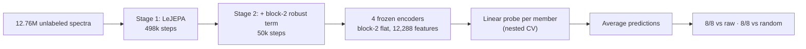
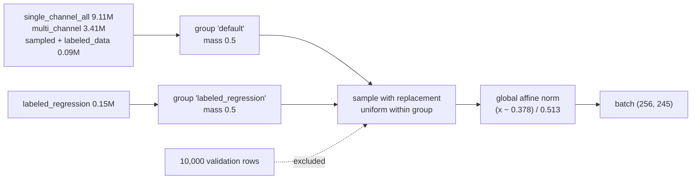
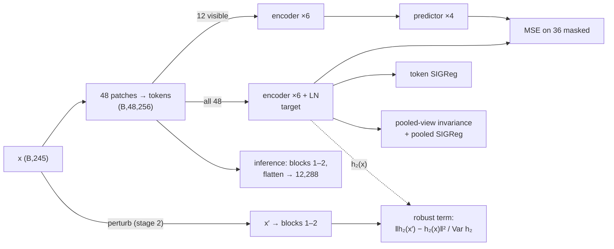
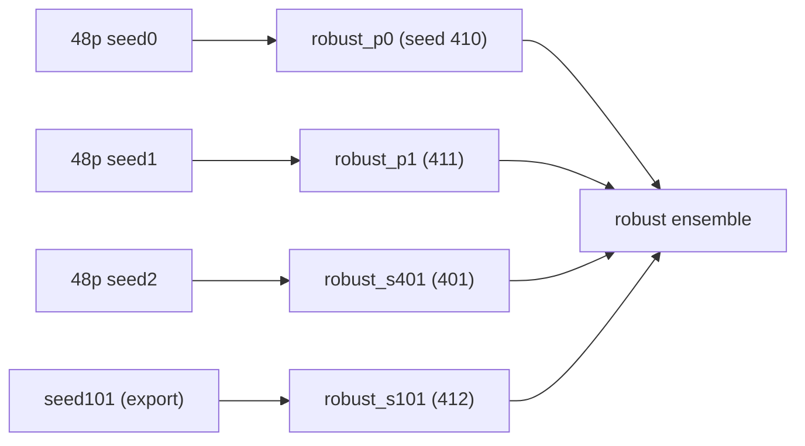
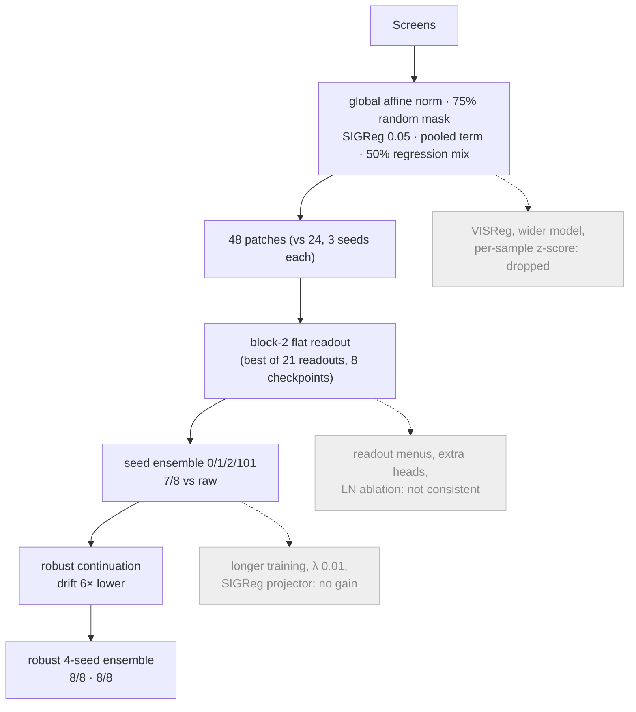
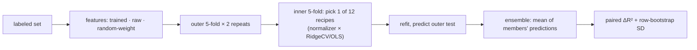
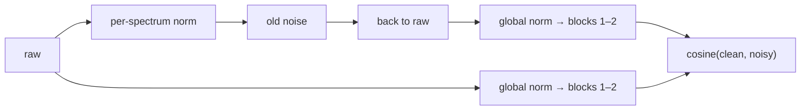

# SpectralFM-LeJEPA training report

Status 2026-10-14. Candidate: **robust four-seed ensemble**, block-2 flat features. Figures: `python -m spectral_lejepa training-report` and `embedding-figures`. W&B project `hcohen/spectralfm-lejepa`.

## 1. Bottom line

**Bottom line.** Frozen block-2 features beat raw spectra on 8 of 8 labeled sets, mean ΔR² +.056, and beat a random-weight encoder on 8 of 8, mean ΔR² +.048. Their 1%-noise drift is about 6× lower than before the robust continuation. Five of the eight gains are within bootstrap noise, and no independent holdout exists yet.



| Set | n | Raw R² | Random-weight R² | Robust ensemble R² | Δ vs raw (± SD) |
|---|---:|---:|---:|---:|---:|
| labeled_data | 4,716 | .830 | .949 | .959 | +.129 ± .004 |
| 0055 | 25 | .591 | .541 | .640 | +.049 ± .127 |
| 0106 | 64 | .697 | .702 | .714 | +.017 ± .022 |
| 0109 | 96 | .918 | .933 | .943 | +.026 ± .011 |
| 0112 | 68 | .377 | .364 | .421 | +.044 ± .117 |
| 0113 | 70 | .548 | .561 | .702 | +.154 ± .060 |
| 0114 | 230 | .983 | .982 | .986 | +.002 ± .001 |
| 0120 | 125 | .380 | .354 | .405 | +.025 ± .054 |

Shaded cells (HTML): the robust ensemble beats raw on that set.


**Figure 1.** R² of raw spectra, the random-weight encoder and the robust ensemble; the labels show Δ vs raw. On labeled_data, the architecture and readout already reach .949 with random weights. Training adds most on 0113, 0055, 0112 and 0120.

## 2. Data

**Bottom line.** All 12.76M spectra are used, labels never. Half of each batch comes from the 0.15M regression-source spectra.



- **Corpus.** Evaluation spectra are in the corpus, so evaluation is transductive in the inputs.
- **Epoch.** One epoch is 49,799 steps of 256 spectra. Details are in `docs/DATASETS.md`.

## 3. Model and objective

**Bottom line.** One shared encoder (no EMA teacher) predicts masked patch embeddings. SIGReg prevents collapse, and in stage 2 a block-2 invariance term makes the shipped features ignore measurement noise.



```text
L = MSE + 0.05·SIGReg(tokens) + [0.95·Var_views + 0.05·SIGReg(pooled)] + 0.1·robust (stage 2)
```

| Part | Output | Parameters |
|---|---|---:|
| Tokenizer: 48 contiguous patches, Linear(6→256) + positions | (B, 48, 256) | 14,080 |
| Encoder: 6 pre-LN blocks, 8 heads, MLP 1024 | (B, 48, 256) | 4,739,072 |
| Predictor: 4 blocks, width 192 | (B, 36, 256) | 1,888,000 |
| **Shipped member**: tokenizer + blocks 1–2 | (B, 12288) | 1,593,600 |

Stage-2 perturbations: each type is applied with probability 0.5, in raw units, then renormalized.

| Perturbation | Range | Source |
|---|---|---|
| Gaussian noise | σ ≤ 0.20 × spectrum SD | corpus p90 noise estimate (Savitzky–Golay residual) |
| Offset / slope / scale | ±5% | earlier perturbation suite |
| Shift | ±1 bin | earlier perturbation suite |

The weight 0.1 is the smallest of {0.1, 0.3, 1} whose block-2 gradient reaches half the MSE gradient (0.195 ≥ 0.056), set in a discarded 1,000-step calibration run.

## 4. Training recipe

**Bottom line.** Training is stable in both stages. Prediction loss still falls at the end of stage 1, and token effective rank stays near 146 of 256, so there is no collapse.

| Setting | Stage 1: pretraining | Stage 2: robust continuation |
|---|---|---|
| Start | random (seeds 0, 1, 2, 101) | stage-1 checkpoint, fresh AdamW |
| Steps | 497,990 (10 epochs) | 49,799 (1 epoch) |
| LR | 5e-4, 1-epoch warmup, cosine to 5e-7 | 5e-5, 1,000-step warmup, cosine to 5e-7 |
| Shared | batch 256, AdamW wd 0.05, 75% random masking, AMP, 1× RTX 2080 Ti | same; about 2 h per run |
| Config | `configs/final_model.yaml`, `configs/paired_long.yaml` | `outputs/robust-ensemble/*/train.yaml` |


**Figure 2. Stage 1.** All four seeds follow the same curves. Regularizers plateau after about 100k steps, and effective rank rises from 90 to 146.


**Figure 3. Stage 2.** The robust term falls about 6× in 10k steps; the weight-0 control stays flat. Prediction MSE rises slightly, the cost of invariance.



## 5. How the recipe was chosen

**Bottom line.** Every component was kept only if it improved the nested-CV benchmark over raw and random controls. Only two later changes added anything: seed ensembling and the robust term.




**Figure 4. Shortlisted models.** The robust term trades margin for consistency: wins over random weights go from 6/8 to 8/8, and the ensemble recovers part of the margin. All three criteria registered before the run passed (`docs/superpowers/specs/2026-10-13-robust-ensemble.md`).


**Figure 5. Members.** Each member loses at most two sets (robust_p1 loses none). Averaging turns all eight positive.

## 6. Evaluation protocol

**Bottom line.** Every probe recipe is chosen inside the training folds. Raw spectra and the random-weight encoder get the identical search, and gains are paired on the same folds.



## 7. Robustness

**Bottom line.** The robust ensemble barely moves under realistic noise and gain changes. Large baseline offsets and heavy shot noise still move it.


**Figure 6. Perturbation suite.** Feature drift falls for every perturbation, including families held out from training (2-bin shift, 5% noise, sinusoidal baseline). Fixed-ridge R² rises under 1–3% noise but drops under a 5% offset and a sinusoidal baseline.

Previous-project noise test (`evaluate --suite embedding`): the old noise types are added in per-spectrum-normalized space and mapped back to raw units. The score is cosine(clean, noisy) of block-2 features.




**Figure 7. Noise cosine, ensemble, 12 sets × 6 noise types.**
- Small Gaussian noise and ±5–10% gain: cosine ≥ .997.
- 2-SD offset: .54–.90.
- Poisson shot noise: .15–.71. It is lowest on labeled_data, the single-channel sets, multi_ch and 0106.
- Block-2 flat and mean behave alike.


**Figure 8. Per dataset.** The members (dots) agree closely, so the ensemble is not hiding a weak member.

## 8. Embedding geometry

**Bottom line.** Block-2 features share one dominant direction. Once it is removed, spectra group by component, as in the raw input. The old stack-retrieval metric is at chance even on raw inputs, so it carries no signal here.


**Figure 9. Fixed 100-spectrum panel** (robust_s401). Raw block-2 cosines are high everywhere. After mean-centring, components within multi_channel, sampled_data and labeled_data form clear blocks.


**Figure 10. Pairwise cosines (sanity set).** Same-stack, random and same-position pairs overlap in every space. Top-5 same-stack retrieval:

| Set | Input | Block-2 mean | Block-2 flat | Chance |
|---|---|---|---|---|
| sanity (N = 100) | .080 | .087 | .091 | .091 |
| in_dist (N = 500) | .016 | .015 | .014 | .018 |

## 9. Limitations and next step

- **Retrospective choice.** The candidate was chosen after about ten studies on the same eight sets. Bootstrap SDs cover row sampling only.
- **Small sets.** Sets have 25–230 spectra, and the gains on 0055, 0106, 0112, 0114 and 0120 are under 1 SD.
- **Transductive evaluation.** Unseen instruments or sources are not measured.
- **Noise test.** It has no raw-input reference, and its noise is seeded where the old code was not. Signal reconstruction was not run, because there is no decoder.

**Bottom line.** Next, score the robust ensemble once on an independent, group-labelled holdout.

## References

- Balestriero & LeCun (2025). LeJEPA. arXiv:2511.08544.
- Assran et al. (2023). I-JEPA. CVPR.
