# SpectralFM-LeJEPA training report

Status 2026-10-14. Candidate: **robust four-seed ensemble**, block-2 flat features. Figures: `python -m spectral_lejepa training-report` and `embedding-figures`. W&B project `hcohen/spectralfm-lejepa`.

## 1. Bottom line

**Bottom line.** Frozen block-2 features beat raw spectra on 8 of 8 labeled sets, mean ΔR² +.056, and beat a random-weight encoder on 8 of 8, mean ΔR² +.048. Their 1%-noise drift is about 6× lower than before the robust continuation. Five of the eight gains are within bootstrap noise, and no independent holdout exists yet.


| Set | n | Raw R² | Random-weight R² | Robust ensemble R² | Δ vs raw (± SD) |
|---|---:|---:|---:|---:|---:|
| labeled_data | 4,716 | .830 | .949 | .959 | +.129 ± .004 |
| 0055 | 25 | .591 | .541 | .640 | +.049 ± .127 |
| 0106 | 64 | .697 | .702 | .714 | +.017 ± .022 |
| 0109 | 96 | .918 | .933 | .943 | +.026 ± .011 |
| 0112 | 68 | .377 | .364 | .421 | +.044 ± .117 |
| 0113 | 70 | .548 | .561 | .702 | +.154 ± .060 |
| 0114 | 230 | .983 | .982 | .986 | +.002 ± .001 |
| 0120 | 125 | .380 | .354 | .405 | +.025 ± .054 |

Shaded cells (HTML): the robust ensemble beats raw on that set.

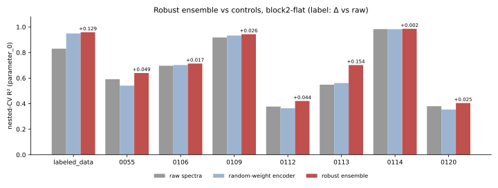

**Figure 1.** R² of raw spectra, the random-weight encoder and the robust ensemble; the labels show Δ vs raw. On labeled_data, the architecture and readout already reach .949 with random weights. Training adds most on 0113, 0055, 0112 and 0120.

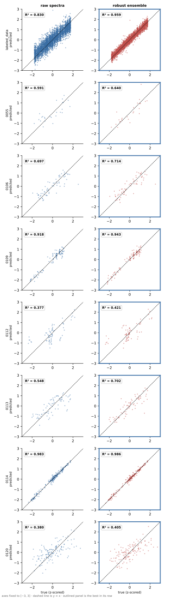

**Figure 2. True vs predicted `parameter_0`, one row per set** (nested-CV out-of-fold predictions, block2-flat; outlined panel is the better one). Axes are in label units and span each set's label range; predictions outside it are clipped to the edge. Points are the mean over the two outer repeats; R² is the reported value. The ensemble tightens the scatter around y = x on every set, most visibly on labeled_data (.830 → .959) and 0113 (.548 → .702). On 0112 and 0120, both models still miss much of the spread.

## 2. Data

**Bottom line.** All 12.76M spectra are used, labels never. Half of each batch comes from the 0.15M regression-source spectra.

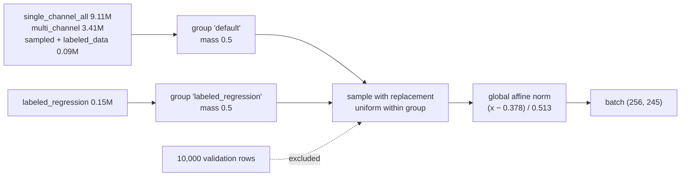

- **Corpus.** Evaluation spectra are in the corpus, so evaluation is transductive in the inputs.
- **Epoch.** One epoch is 49,799 steps of 256 spectra. Details are in `docs/DATASETS.md`.

## 3. Model and objective

**Bottom line.** One shared encoder (no EMA teacher) predicts masked patch embeddings. SIGReg prevents collapse, and in stage 2 a block-2 invariance term makes the shipped features ignore measurement noise.

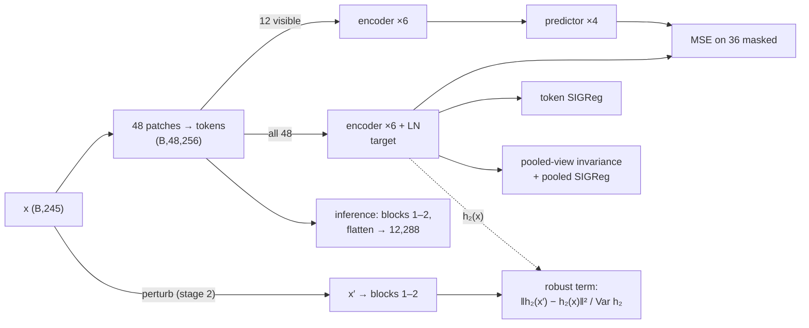

```text
L = MSE + 0.05·SIGReg(tokens) + [0.95·Var_views + 0.05·SIGReg(pooled)] + 0.1·robust (stage 2)
```

| Part | Output | Parameters |
|---|---|---:|
| Tokenizer: 48 contiguous patches, Linear(6→256) + positions | (B, 48, 256) | 14,080 |
| Encoder: 6 pre-LN blocks, 8 heads, MLP 1024 | (B, 48, 256) | 4,739,072 |
| Predictor: 4 blocks, width 192 | (B, 36, 256) | 1,888,000 |
| **Shipped member**: tokenizer + blocks 1–2 | (B, 12288) | 1,593,600 |

Stage-2 perturbations: each type is applied with probability 0.5, in raw units, then renormalized.

| Perturbation | Range | Source |
|---|---|---|
| Gaussian noise | σ ≤ 0.20 × spectrum SD | corpus p90 noise estimate (Savitzky–Golay residual) |
| Offset / slope / scale | ±5% | earlier perturbation suite |
| Shift | ±1 bin | earlier perturbation suite |

The weight 0.1 is the smallest of {0.1, 0.3, 1} whose block-2 gradient reaches half the MSE gradient (0.195 ≥ 0.056), set in a discarded 1,000-step calibration run.

## 4. Training recipe

**Bottom line.** Training is stable in both stages. Prediction loss still falls at the end of stage 1, and token effective rank stays near 146 of 256, so there is no collapse.

| Setting | Stage 1: pretraining | Stage 2: robust continuation |
|---|---|---|
| Start | random (seeds 0, 1, 2, 101) | stage-1 checkpoint, fresh AdamW |
| Steps | 497,990 (10 epochs) | 49,799 (1 epoch) |
| LR | 5e-4, 1-epoch warmup, cosine to 5e-7 | 5e-5, 1,000-step warmup, cosine to 5e-7 |
| Shared | batch 256, AdamW wd 0.05, 75% random masking, AMP, 1× RTX 2080 Ti | same; about 2 h per run |
| Config | `configs/final_model.yaml`, `configs/paired_long.yaml` | `outputs/robust-ensemble/*/train.yaml` |

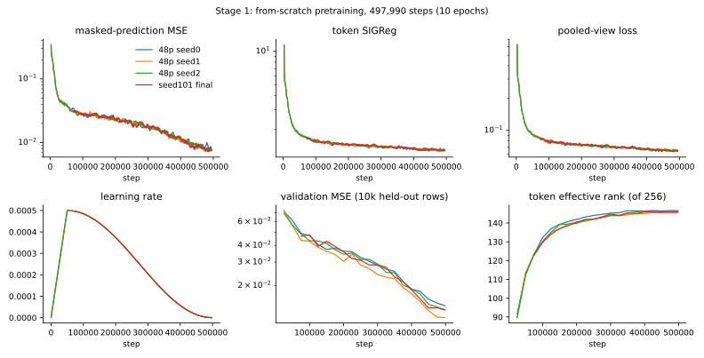

**Figure 3. Stage 1.** All four seeds follow the same curves. Regularizers plateau after about 100k steps, and effective rank rises from 90 to 146.

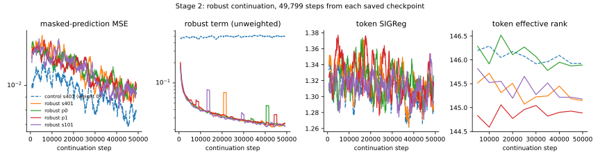

**Figure 4. Stage 2.** The robust term falls about 6× in 10k steps; the weight-0 control stays flat. Prediction MSE rises slightly, the cost of invariance.

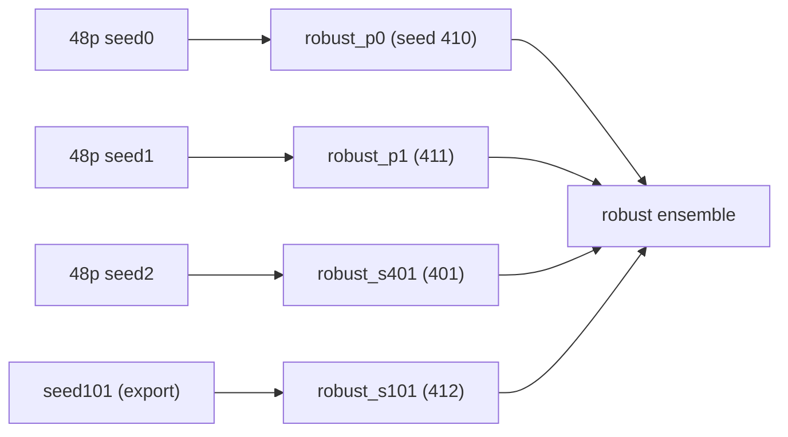

## 5. How the recipe was chosen

**Bottom line.** Each component survived a direct comparison against raw spectra and a random-weight encoder.
- **Kept, from the screens:** global affine normalization, 75% random masking, the pooled-view term, the 50% regression-source mix, 48 patches and the block-2 flat readout.
- **Added later:** two changes improved the result beyond the screens, seed ensembling and the block-2 robust term.
- **Dropped:** everything else (block masking, a wider model, VISReg, projectors, longer or lower-λ continuation, readout menus).

Wins count sets with ΔR² > 0 against raw. Screen 1 scored labeled_data only, and screens 3–4 and 8 are short continuations, so numbers are comparable within a stage, not across stages.

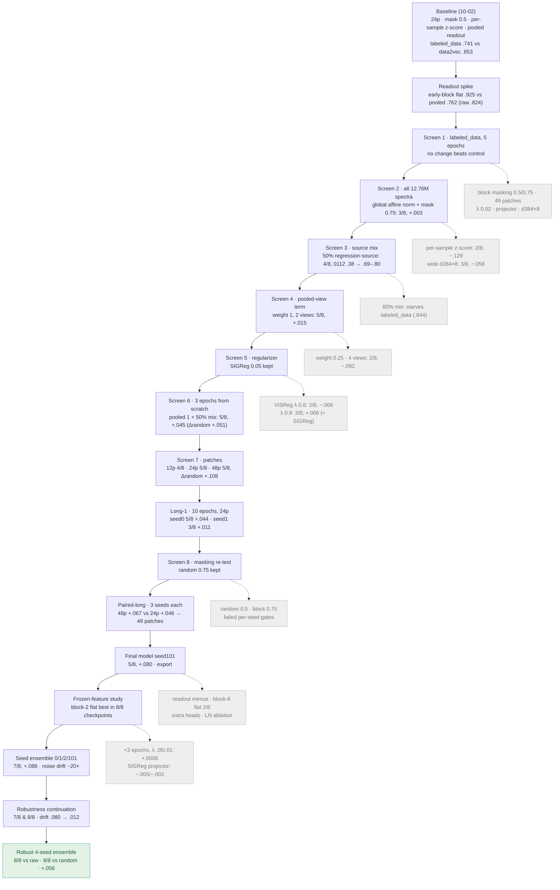

| Stage (date) | Question | Arms → wins vs raw, mean ΔR² | Decision |
|---|---|---|---|
| Baseline (10-02) | Does LeJEPA beat the earlier data2vec model? | Pooled embedding on labeled_data: .741 vs .853. Readout spike: early-block flat .925, seg4 .846, pooled .762; random-weight flat .898; raw .824 | Position-preserving early-block readout; always report a random-weight control |
| Screen 1 (10-02) | Masking, patches, λ, projector, width (labeled_data, 5 epochs) | Control .730/.709. Block mask 0.5 −.044, mask 0.75 −.040, block 0.75 −.080, 49 patches −.130, λ 0.02 −.044, projector −.007, d384×8 −.045 | Nothing beats control; block masking and width dropped |
| Screen 2 (10-06) | Input normalization and capacity on all 12.76M spectra | z-score, mask 0.5: 2/8, −.129. Global affine, mask 0.5: 2/8, −.047. Global, mask 0.75: 3/8, +.003. Wide: 3/8, −.058 | Global affine normalization and mask 0.75 kept |
| Screen 3 (10-06) | Source mix (15k-step continuation) | Natural 4/8, +.005; 50% regression-source 4/8, +.005; 80% 4/8, +.018 | 50%; 80% starves labeled_data (.844); 0112 rises from .38 to .69–.80 with any mix |
| Screen 4 (10-06) | Pooled-view term | Weight 0.25: 4/8, +.015. Weight 1, 2 views: 5/8, +.015 (Δrandom +.021). Weight 1, 4 views: 2/8, −.092 | Weight 1, two half-length views |
| Screen 5 (10-06) | VISReg instead of SIGReg | VISReg λ 0.6: 2/8, −.066; λ 0.9: 3/8, +.006; continued: 2/8, −.041 | SIGReg λ 0.05 kept |
| Screen 6 (10-07) | Recipe from scratch, 3 epochs | Pooled 1: 4/8 (two seeds, −.110/−.001). Pooled 0.25: 3/8, −.031. Pooled 1 + 50% mix: 5/8, +.045 (Δrandom +.051) | Pooled term + 50% mix is the recipe. Seed noise is large (0106 −.87 vs −.08) |
| Screen 7 (10-07) | Patch count | 12: 4/8, +.046. 24: 5/8, +.045. 48: 5/8, +.045, Δrandom +.108 | 24 and 48 move to a full-length comparison |
| Long-1 (10-07) | 10 epochs (24 patches) | seed0 5/8, +.044; seed1 3/8, +.011; random-weight control alone 4/8, −.006 | Longer training helps unevenly across seeds |
| Screen 8 (10-08) | Masking re-test (continuations, 2 seeds) | Random 0.5: 5/8 and 4/8, +.017. Block 0.75: 6/8 and 5/8, +.018. Both fail the pre-registered per-seed gates | Random 0.75 kept |
| Paired-long (10-08) | 24 vs 48 patches, 3 seeds × 10 epochs | 24p: wins 6/5/4, +.046. 48p: wins 5/4/7, +.067. Paired gain +.021 | 48 patches |
| Final model (10-09) | Pre-registered production run, seed101 | 5/8, +.080 | Exported; the 0120 single-shuffle canary (.0204 vs .020) blocks qualification |
| Production analysis (10-11) | Readout policies | Four-readout menu 7/8, +.093; fixed block-2 flat 5/8; block-6 flat 2/8 | Keep the fixed block-2 readout |
| Continuation (10-11) | +2 epochs, λ 0.05 vs 0.01 | Fixed-readout gain +.0006 on average; λ 0.01 regresses | Stop duration-only sweeps |
| Frozen features (10-12) | 21 readouts × 8 checkpoints, extra heads | Block-2 flat best in all 8 checkpoints; Ridge/PLS/RBF heads 4–6/8 | Block-2 flat |
| Projection pilot (10-12) | SIGReg through a projector | −.005 and −.002 vs control (7/8 all) | Dropped |
| Seed ensemble (10-13) | Average 4 seeds' predictions | 7/8, +.086 (random 6/8); trained features amplify 1% noise ~20× | Kept; noise sensitivity found |
| Robustness continuation (10-13) | Block-2 invariance to measured noise | 7/8 and 8/8 vs raw, 8/8 vs random, +.044/+.047; drift .080 → .012 | Robust term kept |
| Robust ensemble (10-13) | Robust term on all 4 seeds | 8/8 vs raw, 8/8 vs random, +.056 | Final model |

### Input normalization

- **The choice.** One fixed affine map for the whole corpus, `(x − 0.3784) / 0.5126`, replaced the per-spectrum z-score inherited from the earlier pipeline.
- **Why.** The per-spectrum z-score removes each spectrum's amplitude and offset, and some labels depend on them.
  - Even a raw-spectrum probe on dataset0055 falls from .591 to .176 when its inputs are z-scored.
  - In screen 2 the z-scored encoder reached .123 on 0055, against .502 with global normalization.
  - The mean gain over raw improved from −.129 to −.047 at an equal 2/8 wins, so the benefit concentrates on small amplitude-dependent sets.
- **Consequence.** Global statistics leave noise and baseline shifts in the input. That is the sensitivity the stage-2 robust term later addressed.

### Not swept

- **Learning rate.** It stayed at 5e-4 for stage 1, with lower rates only for continuations. The long-1 arm names "lr50"/"lr80" denote 50%/80% source mix, not learning rate.
- **Model size.** Only d384×8 was tested against d256×6 at full length. Depths 2 and 4 were trained only in the short ablation of section 8.
- **Pooled-term weight.** Nothing above 1 was tried.
- **SIGReg λ.** At full length, only 0.02 (screen 1) and 0.01 (continuation) were tried, besides 0.05. The short ablation of section 8 adds 0 and 0.2.

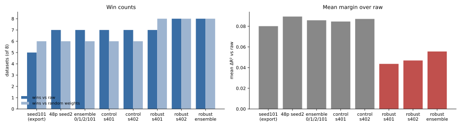

**Figure 5. Shortlisted models.** The robust term trades margin for consistency: wins over random weights go from 6/8 to 8/8, and the ensemble recovers part of the margin. All three criteria registered before the run passed.

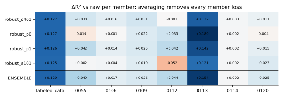

**Figure 6. Members.** Each member loses at most two sets (robust_p1 loses none). Averaging turns all eight positive.

## 6. Evaluation protocol

**Bottom line.** Every probe recipe is chosen inside the training folds. Raw spectra and the random-weight encoder get the identical search, and gains are paired on the same folds.


## 7. Robustness

**Bottom line.** The robust ensemble barely moves under realistic noise and gain changes. Large baseline offsets and heavy shot noise still move it.

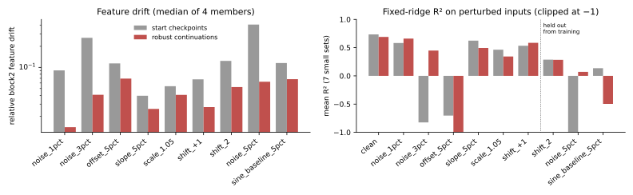

**Figure 7. Perturbation suite.** Feature drift falls for every perturbation, including families held out from training (2-bin shift, 5% noise, sinusoidal baseline). Fixed-ridge R² rises under 1–3% noise but drops under a 5% offset and a sinusoidal baseline.

Previous-project noise test (`evaluate --suite embedding`): the old noise types are added in per-spectrum-normalized space and mapped back to raw units. The score is cosine(clean, noisy) of block-2 features.

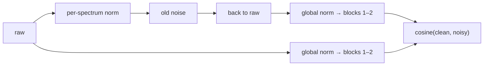

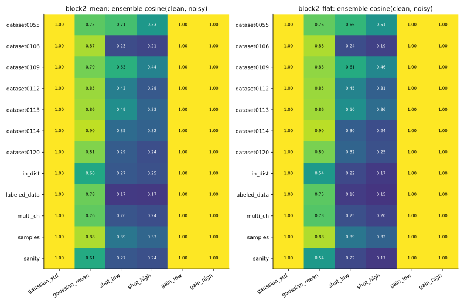

**Figure 8. Noise cosine, ensemble, 12 sets × 6 noise types.**
- Small Gaussian noise and ±5–10% gain: cosine ≥ .997.
- 2-SD offset: .54–.90.
- Poisson shot noise: .15–.71. It is lowest on labeled_data, the single-channel sets, multi_ch and 0106.
- Block-2 flat and mean behave alike.

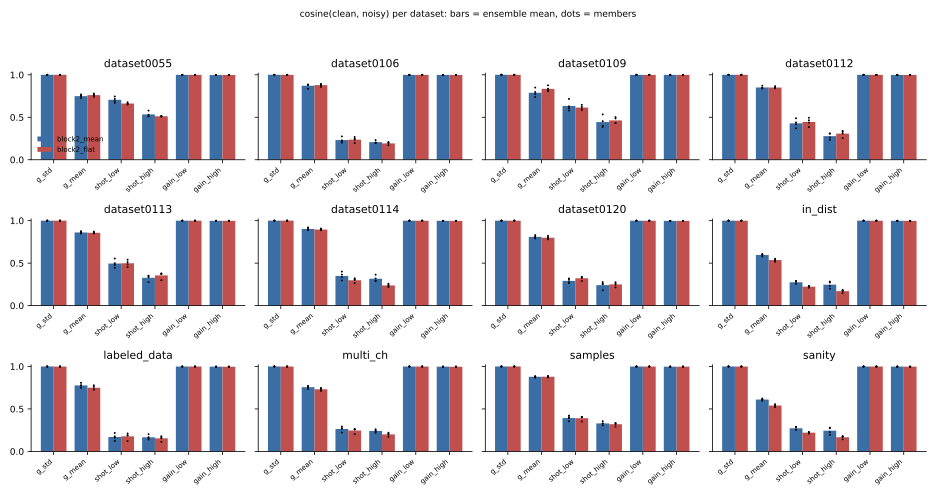

**Figure 9. Per dataset.** The members (dots) agree closely, so the ensemble is not hiding a weak member.

## 8. Why block 2: depth and geometry

**Bottom line.** Training creates the block-2 advantage, and the late blocks destroy it again. Random weights give about the same small gain at every block. Trained features are most useful for prediction at block 2 (+.042, every member between +.031 and +.051) and fall below raw at blocks 5–6 (−.10 and −.13). Isotropy grows with depth, toward the output where SIGReg acts.

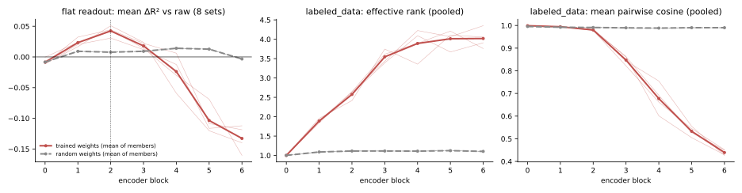

**Figure 10. Per-block profile, four robust members** (thin lines are members, thick lines their mean; dashed lines are random weights).
- **Gain.** Left panel: the flat-readout gain over raw peaks at block 2.
- **Spread.** Middle and right panels, on labeled_data features: training raises effective rank from 1 to 4 and lowers mean cosine from .999 to .44 toward block 6. Random weights stay collapsed onto one direction at every depth (rank 1.1, cosine .99).

- **Why block 6 loses.** The objective acts on the output:
  - SIGReg's gradient at block 6 is about 18× the prediction gradient (gradient audit);
  - the pooled-view term makes masked views agree;
  - a final LayerNorm removes per-token scale.

  The output is pushed toward an isotropic, view-invariant code, which discards the amplitude and position detail that `parameter_0` depends on.
- **Why block 2 wins.** Block 2 has learned useful local features but still carries that detail, and the flat readout keeps all 48 positions.

### Ablations: SIGReg weight and depth

**Bottom line.** SIGReg is what spreads the representation. Without it, every block collapses onto one direction, and block 2 falls below raw. Depth helps block 2: the same block is clearly better in a 6-block encoder than as the output of a 2-block one. All three criteria registered before the runs passed.

- **Design.** Nine runs, each trained from scratch with the stage-1 recipe for 2 epochs instead of 10; they are compared only with each other.
  - SIGReg weight λ ∈ {0, .01, .05, .2} at depth 6 (seed 0). λ also weights the pooled term, so λ = 0 leaves pure invariance.
  - Depth 2, 4 and 6 at λ = .05, seeds 0 and 1.
- **Measurements.** Each run gets the full probe evaluation (all blocks, 8 sets) and isotropy on 10,000 held-out corpus rows.
  - Effective rank is exp(entropy) of the PCA spectrum of mean-pooled features. Rank and mean cosine are scale-free.

| Criterion (registered before the runs) | Result | |
|---|---|---|
| **S1.** At λ = 0, block-6 effective rank is under 10% of λ = .05's, and block-2 gain is lower | rank 9.0 vs 92.3 (9.7%); gain −.014 vs +.082 | pass |
| **S2.** Block-6 effective rank rises monotonically with λ | 9.0 → 42.3 → 92.3 → 116.9 | pass |
| **D1.** Block-2 gain is higher at depth 6 than at depth 2, on both seeds | seed 0: +.082 vs −.048; seed 1: +.076 vs −.225 | pass |

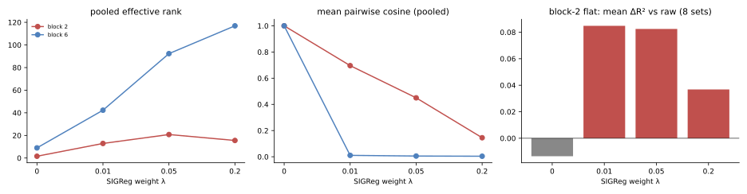

**Figure 11. SIGReg weight, depth 6.**
- **Collapse at λ = 0.** Pooled mean cosine is 1.00 at blocks 1–5, and block-2 effective rank is 1.6. The predictor can still lower the masked loss, but the features carry almost nothing beyond the mean spectrum: block 2 wins on 4/8 sets with a −.014 mean.
- **Any SIGReg fixes it.** Already at λ = .01, block-2 gain is +.085 (6/8 wins), about the same as λ = .05 (+.082, 7/8).
- **Too much hurts.** At λ = .2, block 6 is most isotropic (rank 117), but block-2 gain halves to +.037. Spread is necessary, not sufficient: past a point, SIGReg displaces the prediction signal.

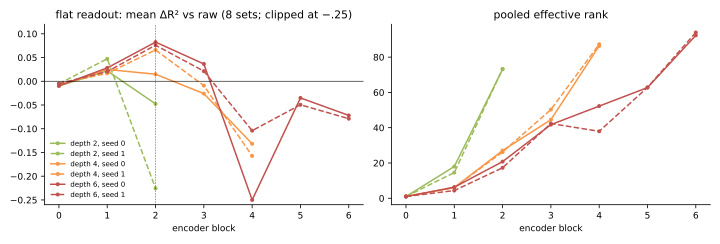

**Figure 12. Depth at λ = .05** (solid lines seed 0, dashed seed 1). Left panel is clipped at −.25. Depth-6 seed-0 block 4 is −.60, driven by one unstable probe on 0112 (R² −4.2).
- **The output block always loses.** In every depth, the last block is the most isotropic and falls below raw. At depth 2, that block is block 2.
- **Block 2 is better with blocks above it.** Block-2 gain is +.08 at depth 6, +.015/+.066 at depth 4, and −.05/−.23 at depth 2. The best block of a 2-block encoder (block 1, +.022/+.047) is still below block 2 of a 6-block one.
- **Likely mechanism.** The upper blocks absorb the SIGReg and invariance pressure, so block 2 can keep local detail while the prediction loss still trains it. On this reading, depth helps block 2 as a buffer, not by being used at readout time. The runs are consistent with this but do not isolate it.

### Embedding geometry (previous-project metrics)

**Bottom line.** Block-2 features share one dominant direction. Once it is removed, spectra group by component, as in the raw input. The old stack-retrieval metric is at chance even on raw inputs, so it carries no signal here.

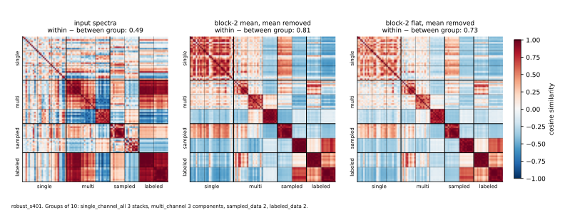

**Figure 13. Fixed 100-spectrum panel** (robust_s401; colour is cosine similarity, −1 to 1). Top row: block-2 cosines are high everywhere (0.4–1), because all features share one dominant direction. Bottom row: after subtracting the mean feature vector, components within multi_channel, sampled_data and labeled_data form clear blocks, as in the input.

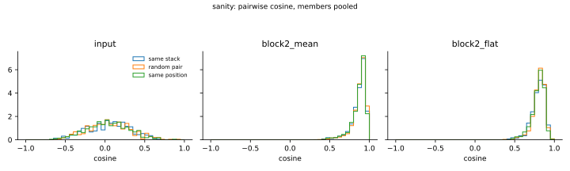

**Figure 14. Pairwise cosines (sanity set).** Same-stack, random and same-position pairs overlap in every space. Top-5 same-stack retrieval:

| Set | Input | Block-2 mean | Block-2 flat | Chance |
|---|---|---|---|---|
| sanity (N = 100) | .080 | .087 | .091 | .091 |
| in_dist (N = 500) | .016 | .015 | .014 | .018 |

## 9. Limitations and next step

- **Retrospective choice.** The candidate was chosen after about ten studies on the same eight sets. Bootstrap SDs cover row sampling only.
- **Small sets.** Sets have 25–230 spectra, and the gains on 0055, 0106, 0112, 0114 and 0120 are under 1 SD.
- **Transductive evaluation.** Unseen instruments or sources are not measured.
- **Noise test.** It has no raw-input reference, and its noise is seeded where the old code was not. Signal reconstruction was not run, because there is no decoder.

**Bottom line.** Next, score the robust ensemble once on an independent, group-labelled holdout.

## References

- Balestriero & LeCun (2025). LeJEPA. arXiv:2511.08544.
- Assran et al. (2023). I-JEPA. CVPR.
