# SpectralFM-LeJEPA training report

Status 2026-10-24. Candidate: **family-mix ensemble** of 16 frozen encoders (8 non-robust, 8 robust), block-2 flat features; the robust four-seed ensemble is the previous candidate. Figures: `python -m spectral_lejepa training-report` and `embedding-figures`. W&B project `hcohen/spectralfm-lejepa`.

## 1. Bottom line

**Bottom line.** Since 2026-10-23 accuracy comes first, and robustness is deferred. The candidate averages the predictions of 8 non-robust and 8 robust encoders as two families, mixed with one weight chosen in inner CV.
- **Against raw:** it beats raw spectra on 8 of 8 labeled sets, mean ΔR² +.095. The previous robust four-seed ensemble gave +.056.
- **Against random weights:** it beats a random-weight encoder average on 8 of 8, mean +.087.
- **Main gain:** 0112 rises from .42 to .72.
- **How it was adopted:** under a rule written after part of the evidence was seen, with one criterion waived (Appendix D). Four of the eight gains are within bootstrap noise, and no independent holdout exists yet.
- **Previous method:** data2vec stays below raw (recent checkpoint 0/8, mean −.197; section 9).
- **Other comparisons and analyses:**
  - Training-free ROCKET-family baselines: Appendix A.
  - Error metrics: section 10.
  - SIGReg geometry: section 11.
  - Robustness: Appendix C. The robust term trades 0112 accuracy for noise robustness.

  Sections 7–11 describe the robust four-member ensemble.

**Inference cost per spectrum** (`ops/inference_flops.py`; matrix multiplies and convolutions counted with PyTorch's FLOP counter, plus the linear readout):

| Model | Encoder | FLOPs per spectrum | Parameters | vs one JEPA member |
|---|---|---:|---:|---:|
| Raw ridge | none (readout on 245 values) | 490 | 245 | — |
| JEPA member | tokenizer + blocks 0–1, readout on 12,288 features | 151 M | 1.6 M | 1× |
| JEPA ensemble | 4 members, predictions averaged | 605 M | 6.4 M | 4× |
| Family-mix ensemble (candidate) | 16 members, two family means mixed | 2.4 G | 25.6 M | 16× |
| data2vec (recent) | conv front end + 12 transformer layers | 9.6 G | 92.6 M | 64× |

data2vec is costed with its full forward pass; its probe selects a block per set, and stopping at that block would cut the cost proportionally. The JEPA encoders stop at block 2, so blocks 3–6 are never run at inference.
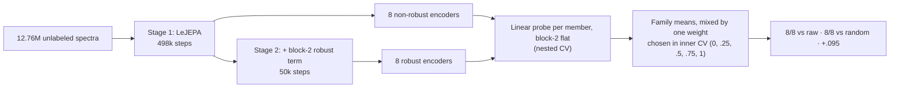

| Set | n | Raw R² | Random-weight R² | Previous: robust ensemble R² | Family-mix R² | Δ vs raw (± SD) |
|---|---:|---:|---:|---:|---:|---:|
| labeled_data | 4,716 | .830 | .949 | .959 | .962 | +.132 ± .004 |
| 0055 | 25 | .591 | .541 | .640 | .596 | +.005 ± .119 |
| 0106 | 64 | .697 | .702 | .714 | .706 | +.010 ± .023 |
| 0109 | 96 | .918 | .933 | .943 | .942 | +.024 ± .012 |
| 0112 | 68 | .377 | .364 | .421 | .715 | +.338 ± .115 |
| 0113 | 70 | .548 | .561 | .702 | .739 | +.190 ± .054 |
| 0114 | 230 | .983 | .982 | .986 | .985 | +.002 ± .001 |
| 0120 | 125 | .380 | .354 | .405 | .439 | +.059 ± .053 |

The random-weight column is the mean over the 16 members' random-weight controls.

Shaded cells (HTML): the robust ensemble beats raw on that set.

**Figure 1.** R² of raw spectra, the random-weight encoder and the robust ensemble; the labels show Δ vs raw. On labeled_data, the architecture and readout already reach .949 with random weights. Training adds most on 0113, 0055, 0112 and 0120.

**Figure 2. True vs predicted `parameter_0`, one row per set** (nested-CV out-of-fold predictions, block2-flat; outlined panel is the better one). Axes are in label units and span each set's label range; predictions outside it are clipped to the edge. Points are the mean over the two outer repeats; R² is the reported value. The ensemble tightens the scatter around y = x on every set, most visibly on labeled_data (.830 → .959) and 0113 (.548 → .702). On 0112 and 0120, both models still miss much of the spread.

## 2. Data

**Bottom line.** All 12.76M spectra are used, labels never. Half of each batch comes from the 0.15M regression-source spectra.

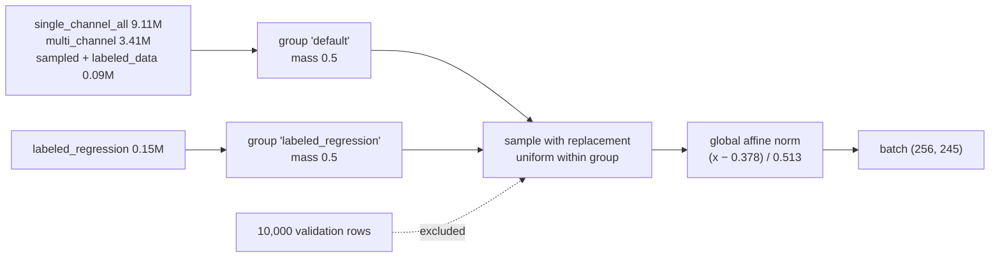

- **Corpus.** Evaluation spectra are in the corpus, so evaluation is transductive in the inputs.
- **Epoch.** One epoch is 49,799 steps of 256 spectra. Details are in `docs/DATASETS.md`.

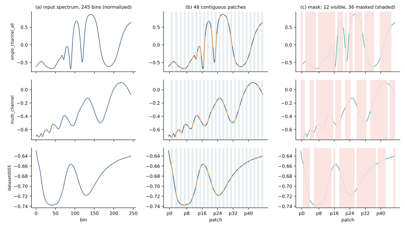

**Figure 3. What the encoder sees.** Three spectra, one each from single_channel_all, multi_channel and dataset0055, after global normalization. (a) The input, 245 bins. (b) The tokenizer cuts it into 48 contiguous patches (alternating colours and bands): 5 of width 6, then 43 of width 5, each zero-padded to width 6 and projected to a 256-d token. (c) One training mask: 36 of 48 patches (75%, shaded, dotted) are hidden, drawn independently per spectrum. The encoder sees the 12 visible patches, and the predictor must produce the encoder's embeddings of the 36 hidden ones. Masks are scattered, but runs of up to 10 hidden patches (about 50 bins) appear in these three.

## 3. Model and objective

**Bottom line.** One shared 1-D ViT encoder (no EMA teacher) predicts masked patch embeddings. SIGReg prevents collapse, and in stage 2 a block-2 invariance term makes the shipped features ignore measurement noise.

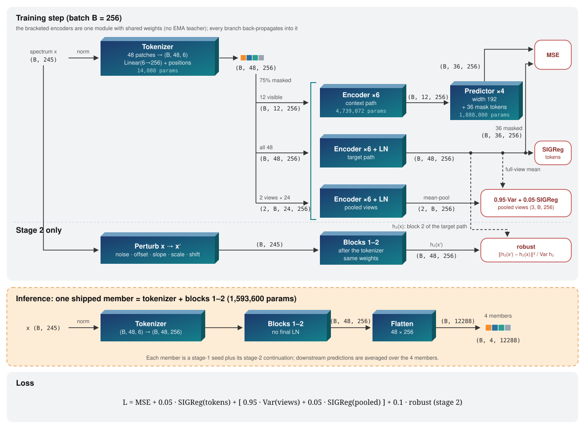

**Figure 4. Architecture and data flow.** Top: one training step. The three encoder rows are the same module, so all branches update the same weights; tensor shapes are on every edge, and loss terms are the red boxes. Positions are learned, not fixed: the tokenizer adds a learned absolute embedding (48 × 256) once at the input, the transformer blocks add none, and visible tokens keep their positions when they are selected. The predictor has its own learned embedding (48 × 192) that places the mask queries. Middle: a shipped member keeps only the tokenizer and the first two blocks and flattens their output. Bottom: the loss.

Stage-2 perturbations: each type is applied with probability 0.5, in raw units, then renormalized.

| Perturbation | Range | Source |
|---|---|---|
| Gaussian noise | σ ≤ 0.20 × spectrum SD | corpus p90 noise estimate (Savitzky–Golay residual) |
| Offset / slope / scale | ±5% | earlier perturbation suite |
| Shift | ±1 bin | earlier perturbation suite |

The weight 0.1 is the smallest of {0.1, 0.3, 1} whose block-2 gradient reaches half the MSE gradient (0.195 ≥ 0.056), set in a discarded 1,000-step calibration run.

## 4. Training recipe

**Bottom line.** Training is stable in both stages. Prediction loss still falls at the end of stage 1, and token effective rank stays near 146 of 256, so there is no collapse.

| Setting | Stage 1: pretraining | Stage 2: robust continuation |
|---|---|---|
| Start | random (seeds 0, 1, 2, 101) | stage-1 checkpoint, fresh AdamW |
| Steps | 497,990 (10 epochs) | 49,799 (1 epoch) |
| LR | 5e-4, 1-epoch warmup, cosine to 5e-7 | 5e-5, 1,000-step warmup, cosine to 5e-7 |
| Shared | batch 256, AdamW wd 0.05, 75% random masking, AMP, 1× RTX 2080 Ti | same; about 2 h per run |
| Config | `configs/final_model.yaml`, `configs/paired_long.yaml` | `outputs/robust-ensemble/*/train.yaml` |

**Figure 5. Stage 1.** All four seeds follow the same curves. Regularizers plateau after about 100k steps, and effective rank rises from 90 to 146.

**Figure 6. Stage 2.** The robust term falls about 6× in 10k steps; the weight-0 control stays flat. Prediction MSE rises slightly, the cost of invariance.

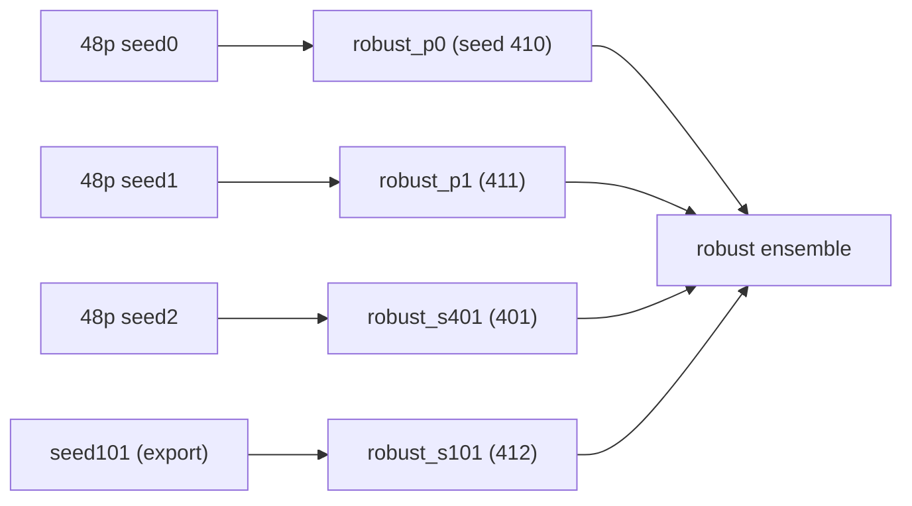

## 5. How the recipe was chosen

**Bottom line.** Each component survived a direct comparison against raw spectra and a random-weight encoder.
- **Kept, from the screens:** global affine normalization, 75% random masking, the pooled-view term, the 50% regression-source mix, 48 patches and the block-2 flat readout.
- **Added later:** two changes improved the result beyond the screens, seed ensembling and the block-2 robust term.
- **Dropped:** everything else (block masking, a wider model, VISReg, projectors, longer or lower-λ continuation, readout menus).

Wins count sets with ΔR² > 0 against raw. Screen 1 scored labeled_data only, and screens 3–4 and 8 are short continuations, so numbers are comparable within a stage, not across stages.

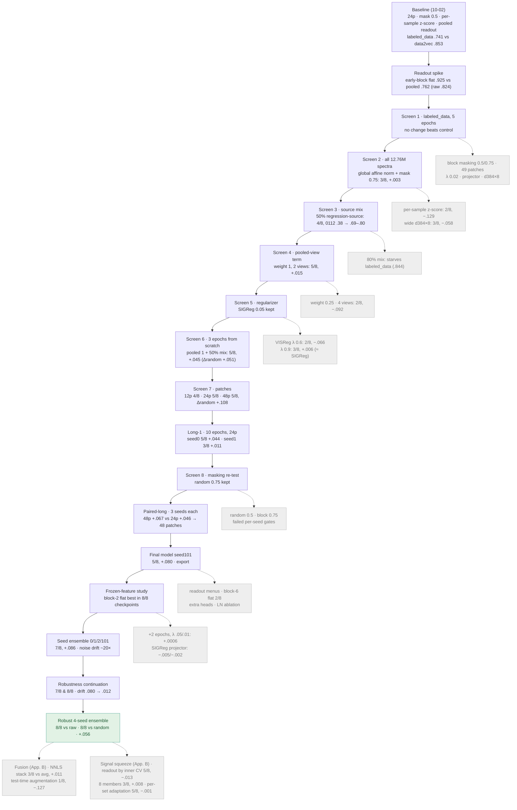

| Stage (date) | Question | Arms → wins vs raw, mean ΔR² | Decision |
|---|---|---|---|
| Baseline (10-02) | Does LeJEPA beat the earlier data2vec model? | Pooled embedding on labeled_data: .741 vs .853. Readout spike: early-block flat .925, seg4 .846, pooled .762; random-weight flat .898; raw .824 | Position-preserving early-block readout; always report a random-weight control |
| Screen 1 (10-02) | Masking, patches, λ, projector, width (labeled_data, 5 epochs) | Control .730/.709. Block mask 0.5 −.044, mask 0.75 −.040, block 0.75 −.080, 49 patches −.130, λ 0.02 −.044, projector −.007, d384×8 −.045 | Nothing beats control; block masking and width dropped |
| Screen 2 (10-06) | Input normalization and capacity on all 12.76M spectra | z-score, mask 0.5: 2/8, −.129. Global affine, mask 0.5: 2/8, −.047. Global, mask 0.75: 3/8, +.003. Wide: 3/8, −.058 | Global affine normalization and mask 0.75 kept |
| Screen 3 (10-06) | Source mix (15k-step continuation) | Natural 4/8, +.005; 50% regression-source 4/8, +.005; 80% 4/8, +.018 | 50%; 80% starves labeled_data (.844); 0112 rises from .38 to .69–.80 with any mix |
| Screen 4 (10-06) | Pooled-view term | Weight 0.25: 4/8, +.015. Weight 1, 2 views: 5/8, +.015 (Δrandom +.021). Weight 1, 4 views: 2/8, −.092 | Weight 1, two half-length views |
| Screen 5 (10-06) | VISReg instead of SIGReg | VISReg λ 0.6: 2/8, −.066; λ 0.9: 3/8, +.006; continued: 2/8, −.041 | SIGReg λ 0.05 kept |
| Screen 6 (10-07) | Recipe from scratch, 3 epochs | Pooled 1: 4/8 (two seeds, −.110/−.001). Pooled 0.25: 3/8, −.031. Pooled 1 + 50% mix: 5/8, +.045 (Δrandom +.051) | Pooled term + 50% mix is the recipe. Seed noise is large (0106 −.87 vs −.08) |
| Screen 7 (10-07) | Patch count | 12: 4/8, +.046. 24: 5/8, +.045. 48: 5/8, +.045, Δrandom +.108 | 24 and 48 move to a full-length comparison |
| Long-1 (10-07) | 10 epochs (24 patches) | seed0 5/8, +.044; seed1 3/8, +.011; random-weight control alone 4/8, −.006 | Longer training helps unevenly across seeds |
| Screen 8 (10-08) | Masking re-test (continuations, 2 seeds) | Random 0.5: 5/8 and 4/8, +.017. Block 0.75: 6/8 and 5/8, +.018. Both fail the pre-registered per-seed gates | Random 0.75 kept |
| Paired-long (10-08) | 24 vs 48 patches, 3 seeds × 10 epochs | 24p: wins 6/5/4, +.046. 48p: wins 5/4/7, +.067. Paired gain +.021 | 48 patches |
| Final model (10-09) | Pre-registered production run, seed101 | 5/8, +.080 | Exported; the 0120 single-shuffle canary (.0204 vs .020) blocks qualification |
| Production analysis (10-11) | Readout policies | Four-readout menu 7/8, +.093; fixed block-2 flat 5/8; block-6 flat 2/8 | Keep the fixed block-2 readout |
| Continuation (10-11) | +2 epochs, λ 0.05 vs 0.01 | Fixed-readout gain +.0006 on average; λ 0.01 regresses | Stop duration-only sweeps |
| Frozen features (10-12) | 21 readouts × 8 checkpoints, extra heads | Block-2 flat best in all 8 checkpoints; Ridge/PLS/RBF heads 4–6/8 | Block-2 flat |
| Projection pilot (10-12) | SIGReg through a projector | −.005 and −.002 vs control (7/8 all) | Dropped |
| Seed ensemble (10-13) | Average 4 seeds' predictions | 7/8, +.086 (random 6/8); trained features amplify 1% noise ~20× | Kept; noise sensitivity found |
| Robustness continuation (10-13) | Block-2 invariance to measured noise | 7/8 and 8/8 vs raw, 8/8 vs random, +.044/+.047; drift .080 → .012 | Robust term kept |
| Robust ensemble (10-13) | Robust term on all 4 seeds | 8/8 vs raw, 8/8 vs random, +.056 | Final model |
| Ensemble fusion (10-20) | Learned head weights; test-time augmentation (Appendix B) | Stack vs average 3/8, +.011; augmentation vs average 1/8, −.127 | Plain average kept |
| Signal squeeze (10-21) | Readout by inner CV; 8 members; per-set adaptation (Appendix B) | 5/8, −.013; 3/8, +.008; 5/8, −.001 vs average | Plain 4-member average kept |
| Stage 2 robustness (10-22) | Which part of Stage 2 drives the trade-off (Appendix C) | Continuation alone: no change; robustness term: 0112 −.07/−.10, 0106 +.03, block-2 rank −30% | Next: frozen stage-1 reference at block 2 |
| Stage 2 reference (10-22) | Frozen stage-1 reference at block 2 (Appendix C2) | mu .01/.04/.16: distance .68 → .18, 0112 vs B: p0 +.02 to +.03, p1 −.02 to +.01; fails on both lineages | Next: whitened (low-variance-weighted) reference |
| Accuracy-first ensemble (10-23) | Mix non-robust and robust members (Appendix D) | M16 +.092 but 0106 −.018 vs raw; family mix +.095, 8/8 vs raw, 4/8 vs R4 | Family mix adopted (5/8 head-to-head waived) |

### Input normalization

- **The choice.** One fixed affine map for the whole corpus, `(x − 0.3784) / 0.5126`, replaced the per-spectrum z-score inherited from the earlier pipeline.
- **Why.** The per-spectrum z-score removes each spectrum's amplitude and offset, and some labels depend on them.
  - Even a raw-spectrum probe on dataset0055 falls from .591 to .176 when its inputs are z-scored.
  - In screen 2 the z-scored encoder reached .123 on 0055, against .502 with global normalization.
  - The mean gain over raw improved from −.129 to −.047 at an equal 2/8 wins, so the benefit concentrates on small amplitude-dependent sets.
- **Consequence.** Global statistics leave noise and baseline shifts in the input. That is the sensitivity the stage-2 robust term later addressed.

### Not swept

- **Learning rate.** It stayed at 5e-4 for stage 1, with lower rates only for continuations. The long-1 arm names "lr50"/"lr80" denote 50%/80% source mix, not learning rate.
- **Model size.** Only d384×8 was tested against d256×6 at full length. Depths 2 and 4 were trained only in the short ablation of section 8.
- **Pooled-term weight.** Nothing above 1 was tried.
- **SIGReg λ.** At full length, only 0.02 (screen 1) and 0.01 (continuation) were tried, besides 0.05. The short ablation of section 8 adds 0 and 0.2.

**Figure 7. Shortlisted models.** The robust term trades margin for consistency: wins over random weights go from 6/8 to 8/8, and the ensemble recovers part of the margin. All three criteria registered before the run passed.

**Figure 8. Members.** Each member loses at most two sets (robust_p1 loses none). Averaging turns all eight positive.

## 6. Evaluation protocol

**Bottom line.** Every probe recipe is chosen inside the training folds. Raw spectra and the random-weight encoder get the identical search, and gains are paired on the same folds.

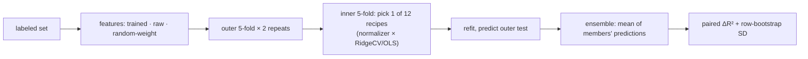

## 7. Robustness

**Bottom line.** The robust ensemble barely moves under realistic noise and gain changes. Large baseline offsets and heavy shot noise still move it.

**Figure 9. Perturbation suite.** Feature drift falls for every perturbation, including families held out from training (2-bin shift, 5% noise, sinusoidal baseline). Fixed-ridge R² rises under 1–3% noise but drops under a 5% offset and a sinusoidal baseline.

Previous-project noise test (`evaluate --suite embedding`): the old noise types are added in per-spectrum-normalized space and mapped back to raw units. The score is cosine(clean, noisy) of block-2 features.

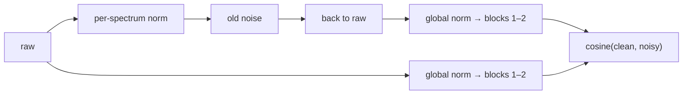

**Figure 10. Noise cosine, ensemble, 12 sets × 6 noise types.**
- Small Gaussian noise and ±5–10% gain: cosine ≥ .997.
- 2-SD offset: .54–.90.
- Poisson shot noise: .15–.71. It is lowest on labeled_data, the single-channel sets, multi_ch and 0106.
- Block-2 flat and mean behave alike.

**Figure 11. Per dataset.** The members (dots) agree closely, so the ensemble is not hiding a weak member.

## 8. Why block 2: depth and geometry

**Bottom line.** Training creates the block-2 advantage, and the late blocks destroy it again. Random weights give about the same small gain at every block. Trained features are most useful for prediction at block 2 (+.042, every member between +.031 and +.051) and fall below raw at blocks 5–6 (−.10 and −.13). Isotropy grows with depth, toward the output where SIGReg acts.

**Figure 12. Per-block profile, four robust members** (thin lines are members, thick lines their mean; dashed lines are random weights).
- **Gain.** Left panel: the flat-readout gain over raw peaks at block 2.
- **Spread.** Middle and right panels, on labeled_data features: training raises effective rank from 1 to 4 and lowers mean cosine from .999 to .44 toward block 6. Random weights stay collapsed onto one direction at every depth (rank 1.1, cosine .99).

- **Why block 6 loses.** The objective acts on the output:
  - SIGReg's gradient at block 6 is about 18× the prediction gradient (gradient audit);
  - the pooled-view term makes masked views agree;
  - a final LayerNorm removes per-token scale.

  The output is pushed toward an isotropic, view-invariant code, which discards the amplitude and position detail that `parameter_0` depends on.
- **Why block 2 wins.** Block 2 has learned useful local features but still carries that detail, and the flat readout keeps all 48 positions.

### Ablations: SIGReg weight and depth

**Bottom line.** SIGReg is what spreads the representation. Without it, every block collapses onto one direction, and block 2 falls below raw. Depth helps block 2: the same block is clearly better in a 6-block encoder than as the output of a 2-block one. All three criteria registered before the runs passed.

- **Design.** Nine runs, each trained from scratch with the stage-1 recipe for 2 epochs instead of 10; they are compared only with each other.
  - SIGReg weight λ ∈ {0, .01, .05, .2} at depth 6 (seed 0). λ also weights the pooled term, so λ = 0 leaves pure invariance.
  - Depth 2, 4 and 6 at λ = .05, seeds 0 and 1.
- **Measurements.** Each run gets the full probe evaluation (all blocks, 8 sets) and isotropy on 10,000 held-out corpus rows.
  - Effective rank is exp(entropy) of the PCA spectrum of mean-pooled features. Rank and mean cosine are scale-free.

| Criterion (registered before the runs) | Result | |
|---|---|---|
| **S1.** At λ = 0, block-6 effective rank is under 10% of λ = .05's, and block-2 gain is lower | rank 9.0 vs 92.3 (9.7%); gain −.014 vs +.082 | pass |
| **S2.** Block-6 effective rank rises monotonically with λ | 9.0 → 42.3 → 92.3 → 116.9 | pass |
| **D1.** Block-2 gain is higher at depth 6 than at depth 2, on both seeds | seed 0: +.082 vs −.048; seed 1: +.076 vs −.225 | pass |

**Figure 13. SIGReg weight, depth 6.**
- **Collapse at λ = 0.** Pooled mean cosine is 1.00 at blocks 1–5, and block-2 effective rank is 1.6. The predictor can still lower the masked loss, but the features carry almost nothing beyond the mean spectrum: block 2 wins on 4/8 sets with a −.014 mean.
- **Any SIGReg fixes it.** Already at λ = .01, block-2 gain is +.085 (6/8 wins), about the same as λ = .05 (+.082, 7/8).
- **Too much hurts.** At λ = .2, block 6 is most isotropic (rank 117), but block-2 gain halves to +.037. Spread is necessary, not sufficient: past a point, SIGReg displaces the prediction signal.

**Figure 14. Depth at λ = .05** (solid lines seed 0, dashed seed 1). Left panel is clipped at −.25. Depth-6 seed-0 block 4 is −.60, driven by one unstable probe on 0112 (R² −4.2).
- **The output block always loses.** In every depth, the last block is the most isotropic and falls below raw. At depth 2, that block is block 2.
- **Block 2 is better with blocks above it.** Block-2 gain is +.08 at depth 6, +.015/+.066 at depth 4, and −.05/−.23 at depth 2. The best block of a 2-block encoder (block 1, +.022/+.047) is still below block 2 of a 6-block one.
- **Likely mechanism.** The upper blocks absorb the SIGReg and invariance pressure, so block 2 can keep local detail while the prediction loss still trains it. On this reading, depth helps block 2 as a buffer, not by being used at readout time. The runs are consistent with this but do not isolate it.

### Embedding geometry (previous-project metrics)

**Bottom line.** Spectra from the same stack or component look more alike in block-2 features than in the input. With the shared mean removed, the within-group minus between-group cosine is .73–.81 for block 2 against .58 for the input. The previous project's stack-retrieval metric is at chance even on raw inputs, so it carries no signal here.

**What is measured.** The previous project's fixed panel of 100 spectra in 10 groups of 10: 3 stacks from single_channel_all, 3 components from multi_channel, 2 from sampled_data and 2 from labeled_data. Each heat map is the cosine similarity between every pair of spectra. If a representation captures what a stack or component has in common, each group forms a bright 10×10 block on the diagonal. The score is the mean cosine within groups (diagonal excluded) minus the mean cosine between groups: 0 means groups are indistinguishable.

Block-2 features are shown after subtracting the panel's mean feature vector. Without that step every block-2 cosine is .4–1, because all features share one dominant direction (section 11), and the maps carry no structure.

**Figure 15. Fixed 100-spectrum panel, robust_s401.** Thick lines separate the four datasets, thin lines the 10-spectrum groups; colour is cosine similarity, −1 to 1.
- **Input spectra** (per-spectrum z-scored, mean not removed): contrast .49; .58 with the mean removed, the fair comparison to the block-2 maps.
- **Block-2 mean and flat, mean removed:** contrast .81 and .73. Groups separate more cleanly than in the input, most visibly in multi_channel and sampled_data. All four robust members agree (mean .80–.81, flat .73).

**Figure 16. Pairwise cosines (sanity set).** Same-stack, random and same-position pairs overlap in every space. Top-5 same-stack retrieval:

| Set | Input | Block-2 mean | Block-2 flat | Chance |
|---|---|---|---|---|
| sanity (N = 100) | .080 | .087 | .091 | .091 |
| in_dist (N = 500) | .016 | .015 | .014 | .018 |

## 9. Comparison with the previous method (data2vec)

**Bottom line.** The previous method does not beat raw spectra. The recent all-data data2vec checkpoint loses all eight sets (mean ΔR² −.197) and the Feb 25 checkpoint wins only labeled_data (−.293). The JEPA ensemble beats both on every set.

Two data2vec-audio checkpoints from the previous project are scored with the same rows, folds and recipe grid as the JEPA members:

- **data2vec (Feb 25)** is `ref_feb25`, the earlier reference; its out-of-fold predictions are read from the previous project's nested-CV runs (mean and segment-mean readouts).
- **data2vec (recent)** is `d2v_alldata` at 200,000 updates, pretrained on all 12.75M spectra. `evaluate` loads it with the previous project's own checkpoint loader and probes every block with the mean, segment-mean and all-token readouts.
  - On labeled_data the full search did not fit in GPU memory, so a fast estimate is used there: mean readout of blocks 0, 6 and 12 only, without the random-weight control. This search is smaller than the other sets', so that number may be slightly low.

| Set | Raw | data2vec (Feb 25) | data2vec (recent) | JEPA ens. |
|---|---:|---:|---:|---:|
| labeled_data | .830 | .853 | .805 | **.959** |
| 0055 | .591 | .199 | .336 | **.640** |
| 0106 | .697 | .250 | .294 | **.714** |
| 0109 | .918 | .066 | .307 | **.943** |
| 0112 | .377 | .233 | .274 | **.421** |
| 0113 | .548 | .259 | .541 | **.702** |
| 0114 | .983 | .981 | .981 | **.986** |
| 0120 | .380 | .140 | .215 | **.405** |
| wins vs raw | | 1/8 | 0/8 | 8/8 |
| mean Δ vs raw | | −.293 | −.197 | **+.056** |

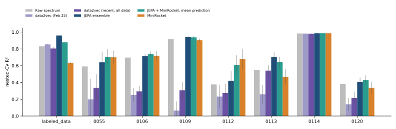

**Figure 17. Nested-CV R² per set** (bars ± bootstrap SD of the paired difference vs raw): raw ridge, both data2vec checkpoints and the JEPA ensemble.

- **data2vec does not beat raw.** The recent checkpoint improves on Feb 25 on the seven small sets, mostly 0109 and 0113, but stays below raw.
- **Random weights.** On the seven small sets the recent checkpoint beats a re-initialised copy of itself on 4/7 sets; only 0113 is a clear gain (+.18). Its features carry little label information beyond what the architecture gives.
- **JEPA vs data2vec.** The JEPA ensemble beats both data2vec checkpoints on every set.
- Training-free ROCKET-family features and JEPA + MiniRocket combinations are compared in Appendix A.

## 10. Error metrics beyond R²

**Bottom line.** RMSE tells the same story as R², with two additions. First, the JEPA ensemble lowers RMSE vs raw on 8/8 sets (mean nRMSE .471 vs .533) and has the smallest tail errors. Second, its error is flat across the label range on labeled_data, while raw ridge and both data2vec checkpoints shrink toward the mean and miss most at the extremes.

All metrics come from the same out-of-fold predictions as section 9 and Appendix A (no refitting): `benchmark score` now writes them to `outputs/benchmark/results.json` (`errors` per set and arm; code in `evaluation/errors.py`). Labels are standardised per set (mean 0, SD 1), so RMSE is in label-SD units and RMSE ≈ nRMSE.

- **RMSE and nRMSE** (RMSE / SD(y)): headline error, comparable across sets. ΔRMSE vs raw is paired on the same spectra, with bootstrap SD.
- **MAE, median and 90th-percentile absolute error:** typical error vs tail error.
- **RMSE by label quintile:** where in the label range a model fails.
- **Bias and residual slope** (slope of prediction − true on true): 0 is ideal; negative means shrinkage toward the mean.
- **Per-spectrum win rate:** share of spectra whose absolute error is below raw ridge's.

| Set | Raw | data2vec (Feb 25) | data2vec (recent) | JEPA ens. |
|---|---:|---:|---:|---:|
| labeled_data | .412 | .383 | .442 | **.203** |
| 0055 | .625 | .877 | .798 | **.588** |
| 0106 | .546 | .859 | .833 | **.531** |
| 0109 | .285 | .961 | .828 | **.237** |
| 0112 | .781 | .869 | .846 | **.752** |
| 0113 | .667 | .853 | .672 | **.542** |
| 0114 | .130 | .136 | .138 | **.120** |
| 0120 | .784 | .924 | .883 | **.766** |
| lower RMSE than raw | | 1/8 | 0/8 | 8/8 |
| mean nRMSE | .533 | .739 | .685 | **.471** |
| mean 90th-pct abs. error | .843 | 1.189 | 1.140 | **.756** |
| mean residual slope | −.28 | −.45 | −.43 | **−.22** |
| per-spectrum win rate vs raw | | .40 | .45 | **.61** |

RMSE per set (lower is better; bold is the best arm).

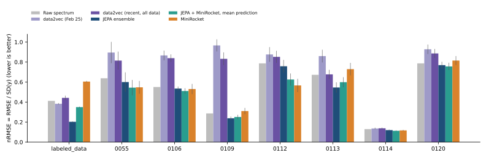

**Figure 18. nRMSE per set** (bars ± bootstrap SD of ΔRMSE vs raw, in SD units).

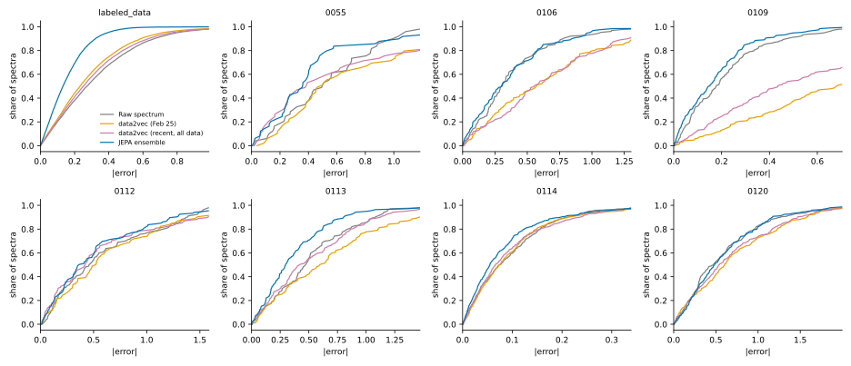

**Figure 19. Cumulative distribution of absolute errors** (both CV repeats pooled; a curve further left and higher is better). On labeled_data the JEPA curve dominates everywhere, so its gain is not driven by a few outliers.

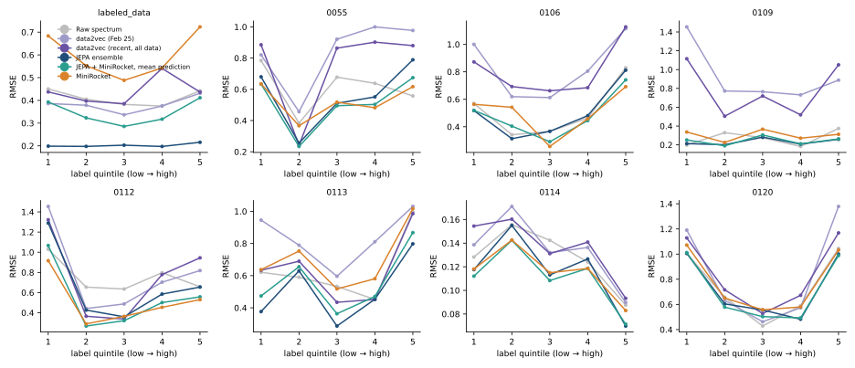

**Figure 20. RMSE by label quintile.** On labeled_data JEPA's RMSE is flat (.20–.22) across quintiles, while raw ridge rises from .38 in the middle to .45 at the low end. On the small sets every arm misses most at the extremes; quintiles there hold 5–46 spectra, so single points are noisy.

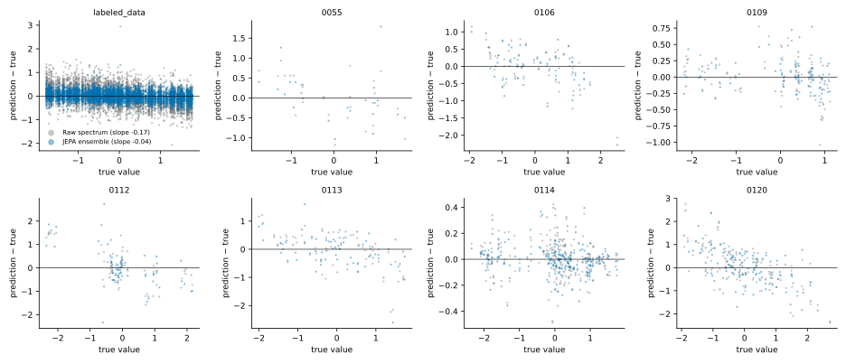

**Figure 21. Residual vs true value, raw ridge vs JEPA ensemble** (first CV repeat). The legend gives the residual slope; on labeled_data it is −.17 for raw and −.04 for JEPA, so JEPA shrinks predictions much less.

- **Agreement with R².** Every arm lowers RMSE vs raw on the same sets where it raises R², as expected: on one set, nRMSE ≈ √(1 − R²) up to the R²/RMSE averaging over repeats.
- **ROCKET family.** RMSE for MiniRocket, ROCKET, MultiRocket and the JEPA + MiniRocket combinations is in Appendix A.

## 11. Feature correlation and SIGReg

**Bottom line.** SIGReg decorrelates the JEPA features and, more usefully, moves label information into directions that carry real variance. Without SIGReg (λ = 0), block-2 dimensions are almost perfectly correlated (mean |off-diagonal| .90) and the label is recoverable only from directions holding under 1e-5 of the variance, near the noise floor. With SIGReg, correlation drops to .46–.50 and the label is spread over directions 10–100× stronger. No setting reaches the identity matrix.

Features are mean-pooled block-2 outputs (256 dims) on all 4,716 labeled_data spectra, for the depth-6 seed-0 ablation runs at four SIGReg weights and one robust ensemble member.

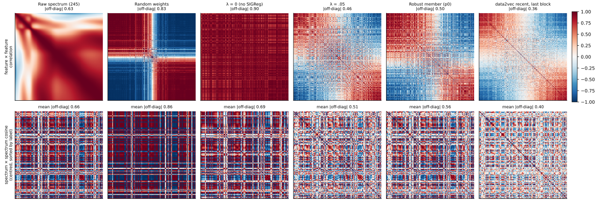

**Figure 22. SIGReg weight vs feature geometry, block 2, labeled_data.**
- **Top: feature × feature correlation.** An isotropic Gaussian, SIGReg's target, gives the identity matrix. The first panel is the raw spectrum's 245 wavelengths in their natural order, for reference: most wavelengths are strongly correlated with each other (mean |off-diag| .63). Dimensions are ordered by their loading on the top principal direction, so one shared direction shows up as a red/blue two-block pattern. Colour −1 (blue) to 1 (red).
- **Bottom left: variance share of each principal direction** (log–log). A steep drop means collapse onto a few directions.
- **Bottom right: label R² of a linear fit on all principal directions down to a variance floor**, with the floor decreasing to the right. The fit is in-sample on pooled features, so it is descriptive. The real probes use the all-token features with nested CV.

| Run (block 2) | mean abs. off-diag | top-PC variance share | label R², directions ≥ 1e-3 | label R², directions ≥ 1e-4 |
|---|---:|---:|---:|---:|
| λ = 0 (no SIGReg) | .90 | 88% | .04 | .06 |
| λ = .01 | .48 | 66% | .09 | .28 |
| λ = .05 | .46 | 56% | .09 | .22 |
| λ = .2 | .50 | 72% | .09 | .12 |
| robust member p0 (λ = .05) | .50 | 71% | .19 | .24 |

- **Collapse at λ = 0.** Variance falls 100× faster than with SIGReg; at direction 20 it is 5e-7, against 5e-5 to 8e-5 with SIGReg. The label is still present in-sample, but only in these near-empty directions. They are easily swamped by noise and heavily shrunk by a ridge penalty, which fits block 2 losing to raw at λ = 0 (section 8).
- **SIGReg weight.** λ = .01 and .05 put the most label information into strong directions. λ = .2 decorrelates as much but carries less label information above 1e-4 (.12), matching its weaker probe gain (block-2 flat mean ΔR² vs raw +.037, against +.085 and +.082).
- **The robust member** has the most label information in its strongest directions (.19 above 1e-3), consistent with stage 2's robustness term.
- **The top direction carries no label.** In every run the top principal direction has |r| ≤ .03 with the label; it is the shared component of all tokens.
- **Why not the identity.** SIGReg tests random 1-D projections of individual tokens, not of the mean-pooled vector. Mean pooling keeps the component shared by all tokens, which carries 56–88% of the variance.

## 12. Limitations and next step

- **Retrospective choice.** The candidate was chosen after about ten studies on the same eight sets. Bootstrap SDs cover row sampling only.
- **Small sets.** Sets have 25–230 spectra, and the gains on 0055, 0106, 0112, 0114 and 0120 are under 1 SD.
- **Transductive evaluation.** Unseen instruments or sources are not measured.
- **Benchmark.** `pred_avg` looks promising, but it was scored on the same eight sets as every earlier study and needs the same holdout.
- **Noise test.** It has no raw-input reference, and its noise is seeded where the old code was not. Signal reconstruction was not run, because there is no decoder.

**Bottom line.** Next, score the robust ensemble once on an independent, group-labelled holdout.

## Appendix A. ROCKET-family benchmark (full comparison)

**Bottom line.** Strong training-free time-series features do not replace the JEPA features. MiniRocket ties the JEPA ensemble 4–4 across the eight sets, but it loses labeled_data by .33, so its mean is .043 below. Averaging the two models' predictions gives the best result in this study: 8/8 wins vs raw, mean +.075, and 5/8 vs the JEPA ensemble alone. All three registered criteria failed, so no combination becomes the candidate.

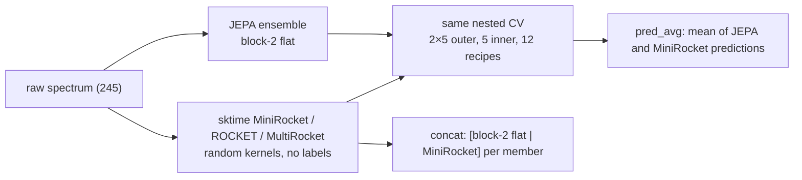

- **Arms.** MiniRocket (about 10k features; seeds 0, 1, 2), ROCKET (10,000 kernels, 20k features) and MultiRocket (about 50k features), all from sktime 1.2.0 and fit on the raw spectra without labels. Each arm uses the members' rows, folds and recipe grid, so every Δ is paired by fold. MiniRocket seed 0 was fixed as the primary baseline before the runs.
- **Combinations.** `pred_avg` is the equal-weight mean of the JEPA ensemble's and MiniRocket's out-of-fold predictions. `concat` joins each member's block-2 flat features with MiniRocket's (22,284 features), probes them and averages the four members. Neither has tuned weights.
- **Registered criteria** (written before the runs; a hand-written ROCKET pilot had already been seen):
  - B1: JEPA beats MiniRocket on ≥ 5/8. **Fail** (4/8).
  - B2: `pred_avg` beats both components on ≥ 5/8. **Fail** (4/8).
  - B3: `concat` beats JEPA on ≥ 5/8. **Fail** (3/8).

Full R² comparison (data2vec columns as in section 9):

| Set | Raw | data2vec (Feb 25) | data2vec (recent) | JEPA ens. | MiniRocket s0 (s1, s2) | ROCKET | MultiRocket | pred_avg | concat |
|---|---:|---:|---:|---:|---:|---:|---:|---:|---:|
| labeled_data | .830 | .853 | .805 | **.959** | .634 (.640, .632) | .530 | .780 | .878 | .731 |
| 0055 | .591 | .199 | .336 | .640 | .699 (.717, .735) | .605 | .695 | **.704** | .690 |
| 0106 | .697 | .250 | .294 | .714 | .719 (.713, .707) | .543 | .668 | **.739** | .712 |
| 0109 | .918 | .066 | .307 | **.943** | .903 (.902, .910) | .809 | .844 | .937 | .938 |
| 0112 | .377 | .233 | .274 | .421 | **.679** (.704, .625) | .429 | .611 | .609 | .649 |
| 0113 | .548 | .259 | .541 | **.702** | .468 (.469, .472) | .521 | .527 | .642 | .558 |
| 0114 | .983 | .981 | .981 | .986 | .986 (.985, .985) | .985 | .985 | **.987** | .987 |
| 0120 | .380 | .140 | .215 | .405 | .336 (.375, .400) | .362 | .422 | **.427** | .333 |
| wins vs raw | | 1/8 | 0/8 | 8/8 | 4/8 | 3/8 | 4/8 | 8/8 | 6/8 |
| mean Δ vs raw | | −.293 | −.197 | +.056 | +.013 | −.067 | +.026 | **+.075** | +.034 |

Bold: best of the JEPA ensemble, MiniRocket s0 and the two combinations.

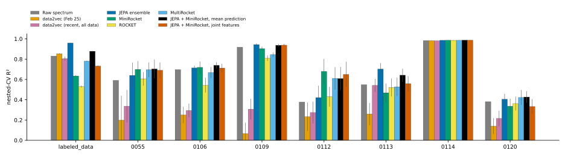

**Figure A1. Nested-CV R² per set, every arm** (bars ± bootstrap SD of the paired difference vs raw). MiniRocket is seed 0; ROCKET and MultiRocket are descriptive arms.

RMSE, every arm (lower is better; error metrics defined in section 10):

| Set | Raw | data2vec (Feb 25) | data2vec (recent) | JEPA ens. | MiniRocket s0 | ROCKET | MultiRocket | pred_avg | concat |
|---|---:|---:|---:|---:|---:|---:|---:|---:|---:|
| labeled_data | .412 | .383 | .442 | **.203** | .605 | .685 | .469 | .350 | .518 |
| 0055 | .625 | .877 | .798 | .588 | .537 | .615 | .541 | **.533** | .545 |
| 0106 | .546 | .859 | .833 | .531 | .526 | .669 | .572 | **.507** | .533 |
| 0109 | .285 | .961 | .828 | **.237** | .309 | .434 | .393 | .250 | .247 |
| 0112 | .781 | .869 | .846 | .752 | **.562** | .750 | .619 | .621 | .587 |
| 0113 | .667 | .853 | .672 | **.542** | .724 | .687 | .683 | .594 | .660 |
| 0114 | .130 | .136 | .138 | .120 | .117 | .122 | .120 | **.113** | .115 |
| 0120 | .784 | .924 | .883 | .766 | .812 | .794 | .757 | **.753** | .813 |
| lower RMSE than raw | | 1/8 | 0/8 | 8/8 | 4/8 | 3/8 | 4/8 | 8/8 | 6/8 |
| mean nRMSE | .533 | .739 | .685 | .471 | .528 | .599 | .523 | **.469** | .506 |

- **Where each wins.** MiniRocket is far ahead on 0112 (+.26 ± .10 over JEPA) and ahead on 0055 within noise. JEPA is far ahead on labeled_data (+.33 ± .01) and 0113 (+.23 ± .08). The two capture different structure, which is why averaging helps.
- **labeled_data.** Every ROCKET-family arm falls below raw ridge there (.53–.78). Inner-CV scores are equally low (.49–.77), so recipe choice is not the cause. These features pool kernel responses nonlinearly and appear to lose the fine linear intensity information that ridge on the raw spectrum, and the JEPA features, keep.
- **Concat underperforms averaging.** One ridge penalty serves both feature blocks, which likely lets the MiniRocket block dominate. Averaging lets each model keep its own probe.
- **Seeds.** MiniRocket's spread across three kernel seeds reaches .08 (0112) and .06 (0120), as large as many of the gaps above.

## Appendix B. Methods that did not help

### B1. Ensemble fusion: stacking and test-time augmentation (2026-10-20)

**Bottom line.** Neither a learned combination of JEPA heads nor test-time augmentation beats the plain four-member average. The average stays the candidate.

**What was tried.** Both arms fuse JEPA features only; raw spectra are a comparison row, never an input.
- **Stacking.** 12 heads: 4 members × {block-2 flat, block-2 mean, block-6 mean}. Each head is probed with its recipe chosen in inner CV. Non-negative least-squares weights, summing to 1, are fitted on the inner-CV predictions of each outer training fold and applied to the outer-test predictions.
- **Test-time augmentation.** Each member's hidden states are averaged over 8 perturbed copies of the input. The perturbations use the robust continuation's training settings (probability 0.5, noise up to the corpus p90, offset, slope and scale up to 5%, ±1-bin shift).
- **Protocol.** Same nested CV as the main results (2×5 outer, 5 inner, 12 recipes, seed 42). The re-run average reproduces the published +.0556 vs raw exactly.
- **Criteria, fixed beforehand.** Beat the average in mean ΔR² and on at least 5/8 sets, and beat raw on 8/8.

| Set | raw | average | stack | aug. average | aug. stack | random-weight average |
|---|---|---|---|---|---|---|
| labeled_data | .830 | **.959** | .958 | .261 | .266 | .949 |
| 0055 | .591 | .640 | .691 | **.694** | .482 | .541 |
| 0106 | .697 | **.714** | .704 | .683 | .705 | .702 |
| 0109 | .918 | .943 | **.947** | .824 | .829 | .933 |
| 0112 | .377 | .421 | **.477** | .328 | .401 | .364 |
| 0113 | .548 | **.702** | .688 | .671 | .586 | .561 |
| 0114 | .983 | **.986** | **.986** | .981 | .980 | .983 |
| 0120 | .380 | **.405** | .404 | .311 | .274 | .354 |
| wins vs raw | | 8/8 | 8/8 | 2/8 | 3/8 | |

- **Stacking.** Beats the average on 3/8 sets, mean +.011. The gain comes from 0055 (+.051 ± .068) and 0112 (+.056 ± .031), two small sets with wide intervals. Elsewhere the weights match the average or overfit slightly.
- **Test-time augmentation.** Beats the average on 1/8 sets, mean −.127. labeled_data falls from .96 to .26.
  - The augmented block-2 features differ from the plain ones by only about 6% in norm (row correlation .998). The label therefore lives in very small feature directions, which training-strength perturbations overwrite.
  - The robust term reduces block-2 drift but does not make these label-bearing directions invariant.
- **Code.** Both options remain available for later studies:
  - `ensemble --stack` (`nested_cv(..., stacks=...)`);
  - `evaluation.tta` (`configs/eval_tta.yaml`).

  Outputs are in `outputs/ensemble-fusion/` (`verdict.json`).

### B2. Signal squeeze: readout selection, eight members, per-set adaptation (2026-10-21)

**Bottom line.** None of the three ways to extract more from the frozen features beats the current four-member average under the criteria fixed beforehand.
- The eight-member average reaches +.063 vs raw on 8/8 (current: +.056), but the whole gain is one set, 0112.
- Four seeds with a linear probe on block-2 flat features look like the ceiling of this model family.

**What was tried.** Every arm is paired with the current average on the same outer folds.
- **A. Readout chosen in inner CV.** For each member and fold, inner CV picks among block-2 flat, block-1 flat, flat blocks 1 and 2 concatenated (24,576 dimensions) and block-2 seg4.
- **B. Eight members.** Four new seeds (103–106), each with stage 1 (`final_model.yaml`) and the stage-2 robust continuation.
- **C. Per-set adaptation.** Each member continues for 5,000 steps with half of its batches drawn from the target set's own unlabeled spectra and half from the rest of the corpus. Labels are never used. Block-2 flat probes; 32 runs.
- **Criteria.** Beat the average in mean ΔR² and on at least 5/8 sets, and beat raw on 8/8.

| Set | raw | average (4) | A: selection | B: 8 members | C: adapted | random-weight (8) |
|---|---|---|---|---|---|---|
| labeled_data | .830 | .959 | .960 | **.960** | **.960** | .949 |
| 0055 | .591 | **.640** | .543 | .632 | .646 | .541 |
| 0106 | .697 | .714 | **.728** | .713 | .709 | .702 |
| 0109 | .918 | .943 | .943 | .942 | **.950** | .933 |
| 0112 | .377 | .421 | .438 | **.489** | .399 | .364 |
| 0113 | .548 | .702 | .672 | .698 | **.727** | .561 |
| 0114 | .983 | **.986** | **.986** | **.986** | **.986** | .982 |
| 0120 | .380 | .405 | .393 | **.411** | .385 | .354 |
| wins vs average | | | 5/8 | 3/8 | 5/8 | |
| mean Δ vs average | | | −.013 | +.008 | −.001 | |

- **A.** Inner CV on 25–70 spectra picks unstable readouts. 0055 loses .097 and 0113 loses .030. Where the pick is stable it helps a little: 0106 picks block-2 seg4 in every fold (+.015), and labeled_data picks block 1 or blocks 1+2 (+.001).
- **B.** The four new seeds score .525 on 0112, against .421 for the original four. They change nothing elsewhere, so the average has saturated on seven sets. 0112's swing tracks the seed draw.
- **C.** Adaptation helps 0113 (+.026) and 0109 (+.007) but hurts the two weak sets it targeted, 0112 (−.022) and 0120 (−.019). More self-supervised training on a set's own spectra does not recover the structure MiniRocket finds on 0112.
- **Code and outputs.**
  - `ensemble --stack --select <readouts> --no-stack-heads` runs arm A.
  - Arm C needs only config: a per-run `data.source_weights` with `training.max_steps`.
  - Outputs are in `outputs/signal-squeeze/`, including `verdict.json`.

## Appendix C. Stage 2 robustness investigation (2026-10-22)

**Bottom line.** The Stage-2 trade-off (0106 up, 0112 down, much better noise robustness) is caused by the robustness term itself, not by restarting training. Within the first 1,000 steps the term compresses block 2: effective rank falls by about a third, and the lowest-variance feature directions shrink by half. Noise consistency alone is enough to produce this. A five-fold lower weight halves the compression and recovers 0112 on one lineage, but loses some robustness and does not reproduce on the second. The recommended next experiment is a frozen stage-1 reference at block 2. All results are exploratory: the benchmark has been inspected before, and release evidence still needs independent group-labelled data.

**Loss and data flow (verified against the code).**

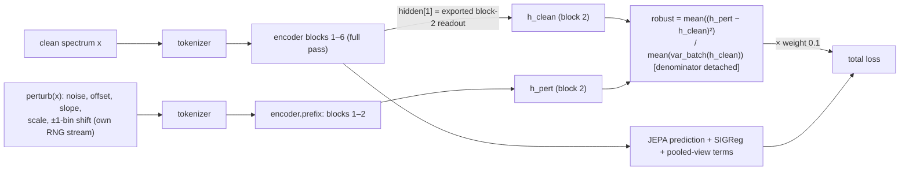

- Gradients flow through **both** the clean and the perturbed branch. Only the variance denominator is detached, so the term has no stop-gradient and no frozen teacher.
- Perturbation draws come from their own generator, so setting the weight to 0 leaves masks and batch order unchanged. That makes arms A–D exactly matched.

**Sanity checks** (tests in `tests/training/test_robust_paths.py`):
- an identity perturbation returns the input;
- the prefix pass equals the full pass at block 2;
- the training block index is the exported readout;
- identical inputs give a robustness loss of 0;
- weight 0 reproduces the base loss and gradients;
- two clean passes in train mode differ by 0 (dropout is 0).

**Runs.**
- Starting points: the stage-1 checkpoints `p48_s0` (p0) and `p48_s1` (p1).
- Training: the stage-2 optimizer and full 49,799-step schedule, stopped at 5,000 steps (`training.stop_step`), with checkpoints at 0, 100, 1,000 and 5,000.
- Seeds: 410 and 411, identical across arms.
- Arms:
  - **A:** robustness weight 0.
  - **B:** current recipe, weight 0.1.
  - **C:** noise only (offset, slope, scale and shift off).
  - **D:** weight 0.02.
- Manifest with SHA-256s: `outputs/stage2-robustness/manifest.json`.

**Scores.**
- All scores are development (inner-CV) R² on outer-training rows, using block-2 flat features with the production probe.
- Noise robustness is the fixed-ridge R² at 3% noise (three draws), with probes fitted on clean rows only.
- Raw and random-weight rows come from the same tool.

| Arm (p0 / p1) | 0112 clean | 0106 clean | noise 3%, mean of 0112 and 0106 | macro Δ vs A | block-2 effective rank | lowest-decile variance | distance from stage 1 |
|---|---|---|---|---|---|---|---|
| step 0 (stage 1) | .594 / .599 | .621 / .623 | | | 66.5 / 67.9 | .018 / .019 | 0 |
| A: continuation only | .618 / .615 | .629 / .632 | −.15 / .03 | 0 | 69.1 / 71.0 | .019 / .021 | .20 / .20 |
| B: current recipe | .546 / .516 | .658 / .663 | .52 / .49 | −.001 / −.011 | 46.1 / 44.7 | .004 / .004 | .68 / .67 |
| C: noise only | .557 / .503 | .657 / .661 | .51 / .49 | +.001 / −.013 | 53.5 / 50.7 | .006 / .006 | .60 / .60 |
| D: weight .02 | .614 / .537 | .641 / .648 | .45 / .45 | +.006 / −.009 | 60.9 / 60.0 | .010 / .010 | .40 / .40 |
| raw spectra (control) | .366 | .679 | | | | | |
| random weights (control) | .375 | .685 | | | | | |

- **Continuation is not the cause.** Restarting the learning rate and resetting the optimizer (A) changes clean R² by at most .025 on any set, and slightly raises effective rank.
- **The term compresses block 2.** In B, rank and the low-variance directions fall within 1,000 steps. The term's gradient points against the JEPA prediction gradient at every saved step (cosine −.11 to −.84 over the shared early encoder).
- **The pattern reproduces on both lineages**: 0106 gains (+.03), 0112 loses (−.07 / −.10), and 0112's noise robustness more than doubles.
- **Noise alone suffices.** C reproduces B's trade-off with slightly less compression.
- **Dose matters.** D halves the compression and the feature displacement. It recovers 0112 on p0 but not on p1, and gives up some noise robustness (.06 on p0, .04 on p1).
- **Pre-fixed criteria.** The macro rules (degrade / no change) did not fire; the effect is set-specific. Under the set-level criterion written before C and D were scored, neither passes on both lineages.
- **Measurement caveat.** On labeled_data, every arm's corrupted R² is hugely negative, including raw ridge (about −5×10⁴ at 1% noise). Perturbation strengths relative to each spectrum's SD exceed that set's label-relevant scale. Its corrupted scores were excluded, and future stress tests need per-set strengths.
- **Open confounds.**
  - The evidence covers 5,000 of 49,799 steps; the full-run endpoints (`robust_p0`, `robust_p1`) show the same direction.
  - C changes total consistency pressure as well as perturbation type.
  - Two lineages are not independent spectra.

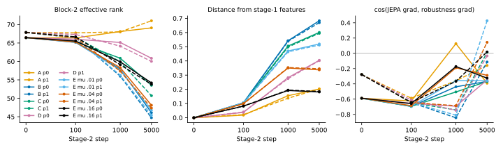

**Figure C1.** Block-2 effective rank, distance from stage-1 features, and cosine between the JEPA and robustness gradients over the first 5,000 Stage-2 steps (solid p0, dashed p1). Includes the E arms (frozen stage-1 reference at block 2, mu .01/.04/.16; Appendix C2).

**Recommended next experiment.** Keep the current robustness term and add a frozen stage-1 reference at the exported block-2 readout: `mu · ||h2_student(clean) − h2_stage1(clean)||²`, with deterministic matching outputs. Choose the coefficient grid from unlabeled loss and gradient scales before looking at labels. This targets the observed mechanism, compression of block 2 away from the stage-1 features, while keeping the term that buys noise robustness. Code and outputs: `stage2-diag` and `stress` commands, `training.stop_step` and `training.save_steps`; `outputs/stage2-robustness/`.

### C2. Frozen stage-1 reference at block 2 (2026-10-22)

**Bottom line.** Pulling block 2 back towards its stage-1 features does not undo the 0112 loss. At the strongest weight, the features end as close to stage 1 as continuation alone (distance .18 vs .20), yet at mu .16, 0112 is still .04 (p0) and .09 (p1) below continuation alone. No weight passes the criterion fixed beforehand on both lineages. The loss is therefore not a general drift away from stage 1. A likely explanation, not tested here, is that the robustness term removes specific low-variance directions that a plain teacher distance, dominated by high-variance directions, does not protect.

**What was tried.**
- B's recipe plus `mu · mean((h2_student − h2_stage1)²) / mean(var_batch(h2_stage1))`, with the stage-1 encoder frozen as teacher (`training.preserve`).
- Three weights, fixed from unlabeled loss scales before any label score: mu = .01, .04 and .16. They make the term ¼×, 1× and 4× the weighted robustness loss at B's 1k-step distance.
- Same seeds, data order and 5,000-step protocol as Appendix C.
- **Criterion:** beat B on 0112 clean dev R² by at least .03; keep the 0112/0106 noise robustness within .05 of B; keep the macro clean dev R² within .005 of continuation alone (A); reproduce on both lineages.

| Arm (p0 / p1) | 0112 clean | 0106 clean | noise 3%, mean of 0112 and 0106 | macro Δ vs A | block-2 effective rank | lowest-decile variance | distance from stage 1 |
|---|---|---|---|---|---|---|---|
| A: continuation only | .618 / .615 | .629 / .632 | −.15 / .03 | 0 | 69.1 / 71.0 | .019 / .021 | .20 / .20 |
| B: current recipe | .546 / .516 | .658 / .663 | .52 / .49 | −.001 / −.011 | 46.1 / 44.7 | .004 / .004 | .68 / .67 |
| E, mu .01 | .570 / .498 | .659 / .658 | .51 / .47 | +.002 / −.014 | 46.8 / 45.4 | .006 / .006 | .52 / .51 |
| E, mu .04 | .567 / .507 | .656 / .662 | .49 / .48 | +.002 / −.010 | 48.1 / 47.3 | .009 / .010 | .34 / .35 |
| E, mu .16 | .578 / .524 | .652 / .653 | .44 / .47 | +.003 / −.007 | 54.2 / 53.8 | .014 / .014 | .18 / .19 |

- **Distance falls with mu, but 0112 barely moves.** At mu .16 the features are back at continuation-only distance. 0112 gains only +.03 on p0 and +.01 on p1 over B, while noise robustness drops by .08 on p0.
- **Rank recovers only partly** (45 → 54 against 70 for A). The lowest-decile variance recovers more, but the label-relevant 0112 directions may not be among those the teacher distance weights heavily (not tested).
- **Verdict.** No mu passes on both lineages. p0 mu .16 meets the 0112 test but loses too much noise robustness; p1 fails the 0112 and macro tests at every mu.

**Recommended next experiment.** Make the reference term sensitive to low-variance directions. Measure the student–teacher distance after whitening by the teacher's fixed per-dimension (or PCA) variances, with a floor and a cap, so that the small directions that carry 0112's signal count as much as the dominant ones. An alternative is to apply the robustness term to block-2 features projected away from the teacher's lowest-variance PCA subspace. Choose the coefficient grid the same way, from unlabeled scales.

## Appendix D. Accuracy-first ensemble (2026-10-23)

**Bottom line.** Mixing non-robust and robust members gives the most accurate model so far. The family mix reaches a mean ΔR² of +.095 vs raw on 8/8 sets, against +.056 for the robust four-member ensemble. It is the candidate, adopted with one criterion waived (see below).

**Why mix.** The two families err differently. Non-robust members are strong on 0112 (.72) and weak on 0106 (.60); robust members are the reverse. This matches Appendix C: the robust term buys 0106 and noise robustness at 0112's expense.

**Members.**
- **Non-robust (8):** stage-1 runs `p48_s0`, `p48_s1`, `p48_s2`, `s101`, plus seeds 107–110 (`configs/final_model.yaml`; `outputs/accuracy-ensemble/members`).
- **Robust (8):** the four previous candidate members plus seeds 103–106 (`outputs/signal-squeeze/members`).
- All banks share labels, rows, raw OOF and folds.

| Set | raw | R4 (previous) | NR8 mean | R8 mean | M16 (all 16 averaged) | family mix | mean non-robust weight |
|---|---|---|---|---|---|---|---|
| labeled_data | .830 | .959 | .963 | .960 | .963 | .962 | .73 |
| 0055 | .591 | .640 | .640 | .632 | .656 | .596 | .55 |
| 0106 | .697 | .714 | .604 | .713 | .678 | .706 | .13 |
| 0109 | .918 | .943 | .926 | .942 | .942 | .942 | .33 |
| 0112 | .377 | .421 | .723 | .489 | .653 | .715 | .85 |
| 0113 | .548 | .702 | .747 | .698 | .732 | .739 | .95 |
| 0114 | .983 | .986 | .984 | .986 | .985 | .985 | .08 |
| 0120 | .380 | .405 | .446 | .411 | .451 | .439 | .40 |
| mean Δ vs raw | | +.056 | +.088 | +.063 | +.092 | **+.095** | |
| worst set vs raw | | +.003 | −.092 | +.002 | −.018 | +.002 | |

**Family mix.**
- In each outer fold, each member's recipe is chosen in inner CV.
- The family predictions are the means of their members.
- One weight w ∈ {0, .25, .5, .75, 1} on the non-robust family is chosen by the inner-CV R² of the mix on outer-training rows only.
- The weight goes robust where robust helps (0106 .13, 0114 .08) and non-robust where that helps (0113 .95, 0112 .85).
- Code: `ensemble --stack --no-stack-heads --mix-groups ...` (`nested_cv(..., mixes=...)`).

**Decision history.** This is stated in full because the rule changed during the study.
1. **First rule, fixed before any score:** beat R4 on at least 5/8 sets with a positive mean, and beat raw on 8/8. M8 and M12 failed it, because 0106 fell below raw.
2. **Second rule, set by the user after seeing those scores, applied forward:** highest mean ΔR² vs raw; beat R4 on at least 5/8 sets head to head; no set more than .01 below raw.
   - M16 failed the tolerance (0106 −.018).
   - The family mix met the mean and tolerance tests but beat R4 on 4/8 sets, not 5. Its losses were 0055 −.044 (the inner CV on 25 spectra picks an unstable weight), 0106 −.007, 0109 −.002 and 0114 −.0002.
3. **Waiver:** the user then waived the head-to-head test, on the grounds that the mix has the highest mean and beats raw everywhere. The family mix was adopted.

These are adaptive choices on the same eight sets, so the gain over R4 is exploratory. Confirmation needs an independent group-labelled holdout.

**Cost.** 16 encoders instead of 4: 2.4 GFLOPs per spectrum. The non-robust members are not noise-robust (Appendix C), so robustness has to be revisited before deployment.

## References

- Balestriero & LeCun (2025). LeJEPA. arXiv:2511.08544.
- Assran et al. (2023). I-JEPA. CVPR.
- Dempster, Petitjean & Webb (2020). ROCKET. Data Mining and Knowledge Discovery 34.
- Dempster, Schmidt & Webb (2021). MiniRocket. KDD.
- Tan, Dempster, Bergmeir & Webb (2022). MultiRocket. Data Mining and Knowledge Discovery 36.
