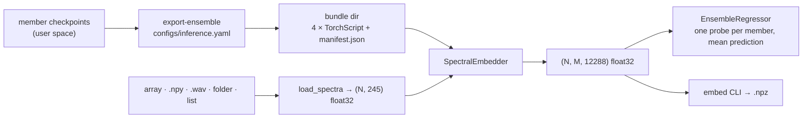

# Inference pipeline — design, 2026-10-14

Status: approved design, awaiting spec review.

## Goal

Anyone with the trained encoders can turn raw spectra into the final embedding with one command or one function call, and use it for downstream tasks. The encoders stay in the user's space, outside git.

## Decisions (user, 2026-10-14)

- **Embedding.** The final embedding is the per-member stack `(N, M, 12288)`: block-2 flat features of each robust ensemble member (M = 4 today). Members are trained independently and their feature spaces are not aligned, so they are never averaged or concatenated by default. A helper fits one model per member and averages predictions, which matches how the ensemble was evaluated.
- **Inputs.** A NumPy array or `.npy` file of raw spectra `(N, 245)`; one `.wav` file; a folder of `.wav` files; or a list of paths.
- **Encoders.** They come from an exported bundle directory built once from the training checkpoints. Inference loads only the bundle.
- **Approach.** `src/spectral_lejepa/inference.py` is self-contained. It imports only `torch`, `numpy`, `soundfile` and `scikit-learn` (for the helper), never training code, so the file plus a bundle runs anywhere.

## Components

### Bundle

- **Default location:** `outputs/inference/robust-ensemble/` (git-ignored).
- **`member_<name>.pt`:** a TorchScript `ProductionEncoder` from `models/export.py`. It takes raw float32 `(B, 245)`, applies the member's global normalization internally, runs blocks 1–2 and returns the flattened `(B, 12288)`. The existing export check compares it to the in-memory model (atol 1e-5).
- **`manifest.json`:**
  - `format_version: 1`;
  - `readout: "layer2/flat"`;
  - `input: {length: 245, dtype: float32, normalization: "inside each encoder"}`;
  - `output: {shape: ["N", M, 12288], dtype: float32}`;
  - `members`: for each, `name`, `file`, `sha256` of the TorchScript file, `source_checkpoint`, `source_sha256`, `step`, `global_stats`.
- **Build:** `python -m spectral_lejepa export-ensemble [--config configs/inference.yaml] [--output DIR]`.
  - `configs/inference.yaml` lists the member names and checkpoint paths, plus the default bundle path.
  - The command refuses to overwrite a non-empty bundle unless `--force` is given.

### `inference.py` API

- `resolve_bundle(bundle=None) -> Path`: the argument first, then the `SPECTRALFM_BUNDLE` environment variable, then the default path. A missing directory or manifest raises `FileNotFoundError`, naming the `export-ensemble` command.
- `load_spectra(x) -> (array (N, 245) float32, ids list[str])`:
  - An ndarray or `.npy` file gets ids `"0".."N-1"`. A `.npy` must be 2-D with 245 columns.
  - A `.wav` file, a folder (`*.wav`, sorted by name) or a list of `.wav` paths uses file names as ids. Each wav must be mono with exactly 245 samples.
  - Errors are `ValueError` naming the offending file or row: wrong length, more than one channel, NaN or Inf, empty input.
- `SpectralEmbedder(bundle=None, device='auto', batch_size=256)`:
  - On load it verifies each member's sha256 against the manifest, and raises `ValueError` on mismatch. `device='auto'` picks CUDA if available.
  - `.members` gives the names; `.embed(x) -> np.ndarray (N, M, 12288) float32`; `.embed_with_ids(x) -> (embeddings, ids)`.
- `EnsembleRegressor(alphas=np.logspace(-3, 3, 20))`:
  - `.fit(features (N, M, D), y)` fits one `StandardScaler` + `RidgeCV` per member.
  - `.predict(features) -> (N,)` returns the mean of the member predictions.
  - It is a convenience baseline, not the benchmark's inner-CV recipe search.
- **CLI.** `python -m spectral_lejepa embed INPUT --output OUT.npz [--bundle DIR] [--device auto|cpu|cuda] [--batch-size 256]`.
  - The `.npz` contains `embeddings (N, M, 12288)`, `ids`, `members` and `bundle_manifest` (as a JSON string).
  - It prints the shape and member names.

## Error handling

Every failure raises before any output is written: no bundle, a checksum mismatch, a bad input shape or values, or a folder with no wavs. The CLI exits non-zero with the message.

## Tests

- **Fast** (tiny model, built with `build_model`, saved as a checkpoint-like file through the existing helpers):
  - `export-ensemble` builds a bundle;
  - `SpectralEmbedder.embed` equals the model's block-2 flat on the same raw spectra (atol 1e-5);
  - a tampered member file is rejected;
  - bundle resolution order;
  - `load_spectra` on arrays, `.npy`, a wav folder (sorted ids) and a list, and on bad inputs (length 240, stereo, NaN, empty folder);
  - `EnsembleRegressor` prediction equals the mean of the per-member fits;
  - the CLI writes the `.npz` with the documented keys.
- **Slow** (the real bundle): embedding dataset0055's `input_raw` equals each member's saved `bank__layer2__flat` in its evaluation run (atol 1e-4).

## Docs

- **README:** an "Inference" section with the build command, a 5-line Python example (embed, fit, predict) and the CLI.
- **CLAUDE.md:** one line under Evaluate.

## Out of scope

Signal reconstruction, per-sample normalization options, pooled readouts, ONNX, and serving or packaging beyond the repo.
